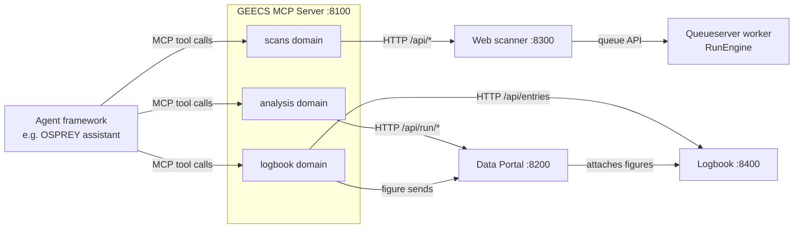

# GEECS MCP Server — overview

**GEECS-MCP** is the GEECS server for AI agents: the one entry point for
every write an agent makes to the machine, and the reads a closed loop
needs. Submit a scan from a preset, wait for it, run the standard
analysis on it, read the numbers, post a draft to the logbook — each as
a typed tool an agent can call, each one a thing an operator can already
do by hand in the web scanner, the Data Portal or the logbook.

This page is a concepts-first orientation. The authoritative detail lives
in the package alongside the code: `GEECS-MCP/DESIGN.md` (the design, verb
by verb), `GEECS-MCP/CLAUDE.md` (the package as built) and
`GEECS-MCP/deploy/DEPLOYMENT.md` (configuration keys, transports, and the
permission-gating semantics). Treat those as the source of truth if
anything here disagrees.

## What "MCP" is

The [Model Context Protocol](https://modelcontextprotocol.io) (MCP) is an
open standard for connecting AI agents to external systems. A server
declares a set of **tools** — named, typed, callable functions with
documented parameters — and an agent connected to that server can invoke
them during a conversation. The agent decides *when* to call a tool from
the conversation's needs; the server decides *what each call is allowed to
do* and returns a structured result.

That split is the whole point. The language model brings flexible intent
("align the beam onto the screen centre"); the server brings a fixed,
reviewable surface (a `submit_preset` tool with exactly these parameters,
that queues exactly what the scanner's Start button queues). Nothing the
agent says can make the server do something outside its tool surface.

## Why GEECS needs its own server

BELLA is already EPICS-fronted through the
[GEECS Gateway](../geecs_gateway/client_overview.md), so an agent framework
with generic EPICS tools can read any process variable without this server
existing. But raw PV access cannot express the operations that actually
matter:

- "Run the Amp4In preset and tell me when it's done" — that is the
  **web scanner's** preflight, queue and progress, not a PV write.
- "What did the beam-profile analysis say about scan 12?" — that is the
  **Data Portal's** Analysis tab and its artifacts.
- "Write that up for the shift" — that is an entry in the **logbook's**
  scans book, filed on the scan's card with its figures attached.

The MCP server exposes exactly these GEECS-semantic surfaces. It
deliberately does **not** duplicate raw-PV channel tools — the agent
framework's own EPICS tools cover channel-level access (see the
[division of labour](osprey.md#the-division-of-labour)).

## Where it sits in the architecture

The server is a **thin HTTP client of three services** and nothing else:
the [web scanner](../web_services/scanner.md) (GeecsScanner, `:8300`),
the [Data Portal](../web_services/data_portal.md) (`:8200`) and the
[logbook](../web_services/logbook.md) (GeecsLogbook, `:8400`). It imports
no engine code, reads no archive directly and runs no analysis of its
own. Preflight, range limits, config resolution and the analysis job
queue stay where an operator already sees them, so what the agent does is
what an operator sees on the scanner page and the portal's Analysis tab —
and a rule a service enforces comes back as that service's refusal, in
its own words.



Scan execution stays entirely in the GEECS engine (the queueserver
worker, driven by the scanner); the MCP never drives devices shot by
shot. Moves go through the scanner's `mv` plan, so the same range limits
and put-failure handling apply as in a scan. Channel-level setpoint
writes through the agent framework's own EPICS tool remain possible but
bypass that GEECS hardening — which is why operations with GEECS
semantics belong behind an MCP verb.

## Domains

Tools are organised into **domains**, one per service:

| Domain | Behind | What it covers |
|---|---|---|
| [Scan service](scan_service.md) | scanner | Status, progress, queue history, config catalogs; `submit_preset`, `move`, `wait_for_scan`; stop / pause / resume / clear_queue |
| [Analysis](analysis.md) | portal | Per-scan analysis listing, figures, artifacts and binned scalars; `run_analysis` / `wait_for_analysis` |
| [Logbook](logbook.md) | logbook + portal | `post_logbook_entry`: a draft in the scans book, figures attached by the portal |

## The safety model

Every tool belongs to one of three classes (`geecs_mcp/tool_names.py` is
the one place the names and the `READ_TOOLS` / `WRITE_TOOLS` /
`STOP_TOOLS` groupings are spelled; the deployment's permission lists
import them, never retype them):

- **R — read.** Status, listings, figures, numbers, and the two wait
  verbs (they poll and change nothing). Auto-allowed.
- **W — write.** Every verb that queues work, moves hardware or writes a
  record: `submit_preset`, `move`, `resume_scan`, `clear_queue`,
  `run_analysis`, `post_logbook_entry`. The deployment's tier decides
  their posture; headless operation gates them through the agent
  framework's `write_tools` list, derived from `WRITE_TOOLS`.
- **S — the halt family.** `stop_scan` and `pause_scan`. **Never listed
  in `write_tools`** — a halt must never be blocked on any path. Making
  the machine quieter is always allowed.

Two rules sit on top of the classes:

- **The agent never acknowledges a preflight question itself.**
  `submit_preset` returns the scanner's questions verbatim; the person
  supervising answers them and the agent passes the answers back. A
  destructive analysis kind's typed confirmation is likewise passed
  through, never filled in.
- **Identity is a record, not an authorization.** `submit_preset`,
  `move`, `resume_scan` and `post_logbook_entry` require an `operator`
  argument — the supervising person's name — and send
  `agent, admin supervision (<operator>)`. The scanner records it on the
  submitted run (`md.geecs.operator`) and the logbook records it as the
  entry's author; the scanner's move does not yet stamp it on the queued
  item. `stop_scan` and `pause_scan` pass it on when given and never
  refuse over it. `clear_queue` and `run_analysis` take no operator (the
  portal's analysis route has no field for one). The string says who
  supervised; what an agent may call is enforced by OSPREY's permission
  lists and hooks, described in `GEECS-MCP/deploy/DEPLOYMENT.md`.

## Conventions every tool follows

- **Tools never raise.** Every result is a JSON envelope: `ok: true`
  plus the payload, or `ok: false` with an `error_kind` from a fixed set
  — `invalid_request`, `not_found`, `policy_refusal` (the scanner's own
  vocabulary), `service_unreachable` (with which service and URL), and
  `internal_error` — and a message that preserves the service's own
  wording.
- **A scan is named by scan number and day** (today when omitted). A
  number the day does not hold is `not_found`; the server never falls
  back to the day's newest run.
- **Payloads are context-sized.** Job logs are cut to a 40-line tail,
  artifact reads are byte-capped, figures are *references* (the portal's
  artifact URL). Image bytes reach the model only through an explicit
  thumbnail, returned as an MCP image block. Anything truncated says so.
- **Waits are bounded and honest.** `wait_for_scan` and
  `wait_for_analysis` block for at most 600 s; a timeout is a result
  (`finished: false`), not an error, and the agent calls again.
- **A write is reported once it has happened.** A logbook post is ok as
  soon as the entry exists, with a row per figure saying what attached;
  the agent must not post again (that would make a second entry).
- **Everything degrades honestly.** The server always starts; an
  unconfigured or unreachable service turns its verbs into
  `service_unreachable` refusals naming what is missing.

## Configuration and deployment

Configuration is only the `[mcp]` section of the service account's
`~/.config/geecs_python_api/config.ini`:

```ini
[mcp]
scanner_url = http://<services host>:8300
portal_url  = http://<services host>:8200
logbook_url = http://<services host>:8400
```

The deployment renders it from the site profile; an unset URL makes that
service's verbs answer `service_unreachable` naming the key.
`GEECS-MCP/deploy/DEPLOYMENT.md` is the full key inventory and the
deployment runbook. Two transports exist: **stdio** (the dev loop — the
agent framework launches the server as a subprocess) and **central HTTP**
(one server process on the lab server at `:8100/mcp`, reachable from any
OSPREY machine on the network).
