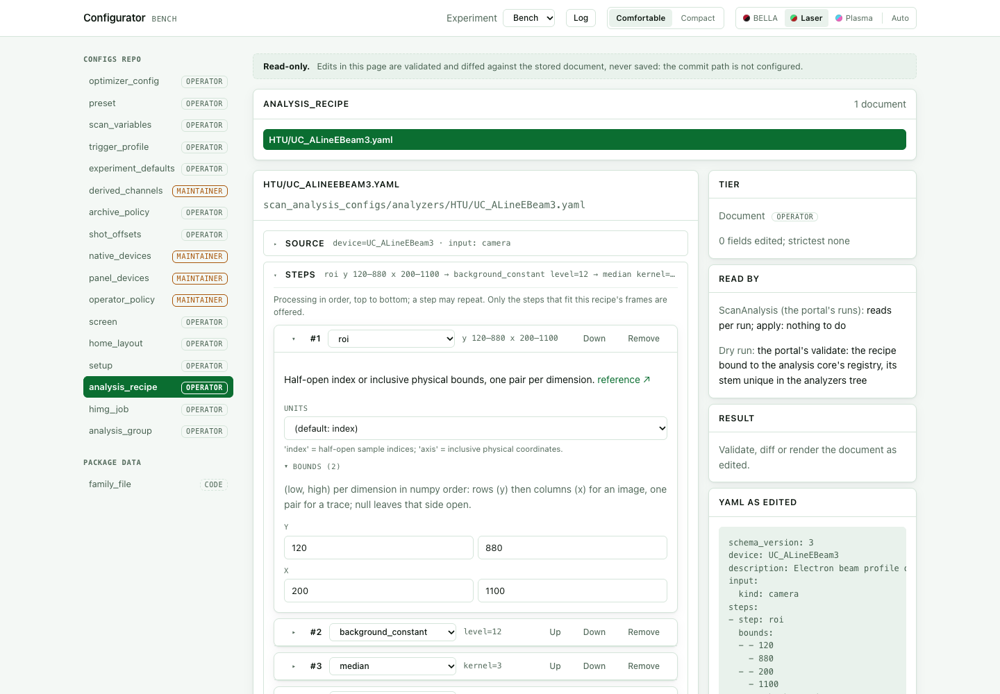
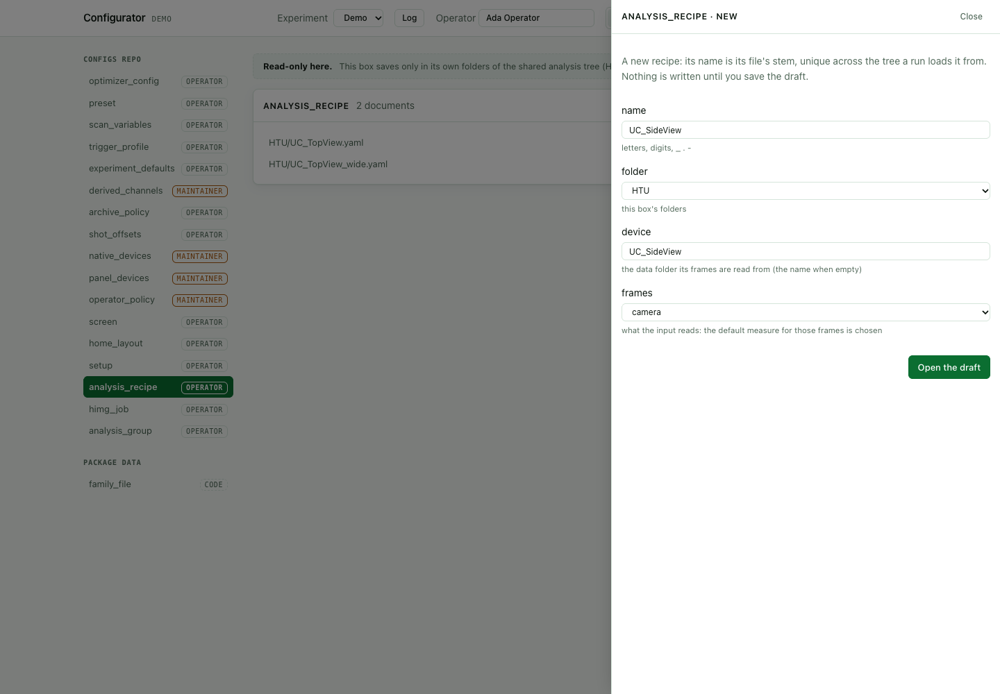
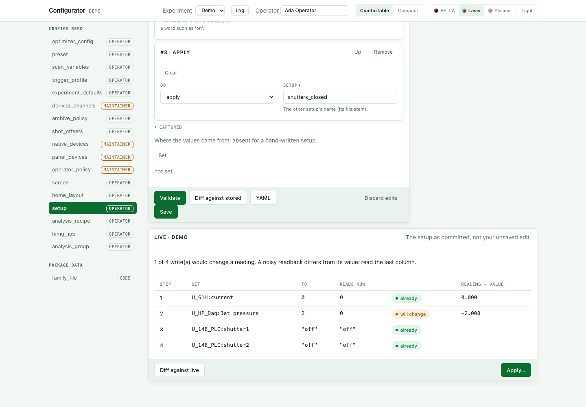

# Configurator

The configurator edits the configuration files in the configs repository.
That covers trigger profiles, presets, scan variables, setups, screens, the
analysis recipes and the rest: every kind GEECS reads from it is drawn as a
form from its schema. It is a service of its own (port 8800 in the reference
deployment).

A save is a commit, under your name. You never edit a file on the share by
hand, and nothing is left uncommitted.

!!! note "Name yourself first"
    Type your name in the header's **Operator** field before saving. It is
    the commit's author. A save without it is refused, and the page
    remembers the name in this browser.

## Finding a document

The rail lists every kind. **Configs repo** holds the files you edit;
**package data** (family files) is shown read-only, because it changes by a
pull request to GEECS-Plugins. Pick a kind to list its documents, then pick
a document to open its form. The experiment selector at the top switches
experiments.

A document that belongs to another facility's services box is shown
**read-only here**. You can browse it, but it is saved from the box that
owns it or by a pull request.

An analysis recipe opens in sections (Source, Steps, Measure, Figure,
Summaries, Scan), each closed to one line that says what is in it; open
the one you are changing. A step is one line too, its kind in a list:
open it for its parameters, a link to its reference card and, for the
measure, the scalars it writes. The lists offer only the steps and
measures that fit the recipe's frames (images or traces), and an ROI is
one row per axis. The step and measure lists come from the data portal:
on a box whose configurator has no portal, a banner says so and a step is
typed by name. The YAML of the recipe as edited is shown beside the form.

## Editing and saving

- **Validate** checks the form against the schema. **Diff against stored**
  lists what you changed. **YAML** shows the file as it would be written.
  None of these write anything.
- The **Tier** panel says what Save will do with your change:
  - an **operator** change commits to the configs repo's main;
  - a **maintainer** change opens a pull request for the maintainer's
    review (the operator policy, the device registry, derived channels);
  - the strictest changed field decides.
- **Save** first asks the document's reader to check your draft. That is the
  scanner for a trigger profile, the archiver for the archive policy, and the
  data portal for an analysis recipe or group. A refusal is shown at the
  fields it names, and nothing is saved. A check that passes with nothing to ask saves on that
  one press. A check that could not run, skipped part of itself, asks a question or prints a plan
  (the archiver's) is shown first, with a second Save under it to confirm.
  Either way the save commits (or proposes) and says what happened.
- If someone changed the file since you opened it, Save says so, shows what
  your edit would change in the file as it is now, and keeps your edit in
  the form. Nothing is merged for you.
- A trigger profile with no `schema_version` (an empty file, or the retired
  legacy format) is shown invalid, and the scanner refuses it. The form cannot
  save it valid: fix the file by hand in the configs repository, or, when no
  preset or experiment default names it, delete it and save a copy of a valid
  profile under its name (a delete is refused while something names the file).
- Edits you make while a save is on its way stay in the form, marked
  unsaved.

**Whether it took effect** is on the **Log** page. A commit is not the same
as applied: the worker reopens its environment when the queue is idle and
empty, the archiver re-onboards, and a restart is handed to the maintainer.
Each row says which.

## New, copy and delete

- **New recipe… / New group…** (on the kind's list, and in the drawer)
  asks for a name, one of this box's folders and, for a recipe, its data
  folder and frame kind. It then opens a draft that already works: no
  processing steps, and the standard measure for those frames. Nothing is
  written until you Save. A name another recipe or job already
  uses, anywhere in the analyzers tree, is refused.
- **Save as a copy** writes the form as a new file beside the original,
  under a new name.
- **Delete…** first checks whether another document names this one. If one
  does, the delete is refused and the referrers are listed. Otherwise you
  confirm by typing the document's name. The file stays in git's history.

## Setups

A setup is a named device state ("low power"): ordered set, wait and check
steps. On a setup's page:

- **Capture from live…** reads the readbacks of the variables you list
  and drafts a setup from them. Nothing is written to a device.
- **Diff against live** compares the setup as committed with the
  machine now.
- **Apply…** queues the setup on the scanner as one item. You confirm the
  scanner's questions (the hazards) first.

Apply waits while the form holds an unsaved edit: what is applied is the
setup as committed.

## From other pages

The scanner's preset panel and the data portal's Analysis tab (**edit**,
with the portal's preview of your unsaved recipe on the scan) open the same
editor in a drawer. The Control Room's launcher links here. The save is the
same everywhere.
