# Control Room

The Control Room is the experiment's home page and its device screens, in
the browser. The home tells you at a glance what is running, which devices
are not live or in alarm, and whether the machine still matches its
baseline. From it you open the screens: dense control panels, one per area,
where you read and set devices. It is a service of its own (port 8700 in
the reference deployment) over Canopy and the GEECS device module, so the
same page works from any machine that can reach it.

Every write you make goes through the GEECS device module, which checks it
(who may write, the device's allow list, the hazard confirm, the run lock,
the limits) and writes one journal row naming you. The page sends each
write **once** and shows the module's answer; it never retries on its own.

!!! note "Name yourself first"
    Type your name in the header's **Operator** field before writing,
    running an action or saving a preset. Without it nothing is sent and a
    screen widget says `unsent · name yourself in the header first`. The name goes
    into the journal; the page remembers it in this browser.

## The home

The screenshots on this page are from the simulator bench, running under
the reference deployment's experiment name.

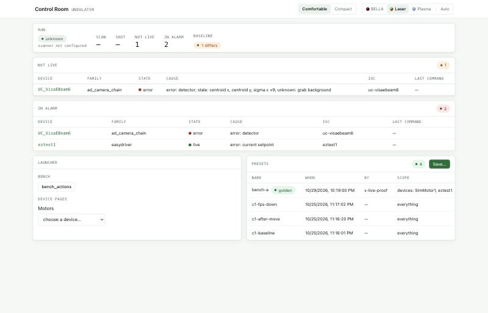

### The strip

The top row is the summary:

| Field | What it says |
|---|---|
| **Run** | The scan engine's state as the scanner sees it (`idle`, `running`, `paused`, …), with the current scan and shot. `scanner not configured` when the deployment gives no scanner address. |
| **Not live** | How many devices are not fully live. |
| **In alarm** | How many devices have an error. |
| **Baseline** | Shown only when a preset is marked golden. `as baseline` when every saved row matches the live value, `N differ` when some do not, `N not compared` when a row could not be read; it never says `as baseline` while a row is uncompared. |

### Not live and In alarm

Two lists below the strip. **Not live** is every device whose state is
anything but `live`; **In alarm** is every device whose state or any of
whose roles reads `error`. Each row gives the device, its family, its state,
the cause (which roles read which word), its IOC, and the last command the
module journaled for it. A list the module could not give reads `unknown`,
never `none`: an empty list is a fact, an unknown one is not.

The words are the module's verdicts, the same on the home and on every
screen:

| Word | Meaning |
|---|---|
| `live` | The value is being produced now: its counter advanced recently, and it is not in alarm. |
| `stale` | Connected, but the value has stopped updating (its counter has not advanced for a few seconds). The number on screen is old. |
| `off` | The computation behind the value is switched off on the IOC (a statistics plugin disabled, for example). |
| `not answering` | The IOC answers, but the hardware behind it does not (a read, communication or timeout alarm). |
| `unreachable` | The PV is not connected: the IOC, the gateway or the network is down. For a LabVIEW device served by the CA gateway, its device is Disconnected. |
| `error` | A major or invalid alarm, or a tripped fault bit. |
| `unknown` | Nobody can say: the module or the live-value stream is silent, or the record was never processed. |

On a screen you may also see `unknown role` (the screen names a role the
module does not list for that device) or `wrong kind` (the role exists but
does not fit the widget, a setpoint bound to a read-only value, say). Both
are screen-file problems to report, not device faults.

A screen that cannot be drawn at all names its problems instead, and when
they share one cause, that cause comes first: the module has not read the
GEECS DB (its login refused, say), so no DB device on the screen can bind.
Fix the cause, not the screen. The error page asks the server again every
30 s on its own (no script runs on it), so it draws once the module's next
DB read succeeds, within a minute or two; a missing screen file does not
retry.

A value changing on screen is never evidence that it is live; only the
word is.

### The launcher

The launcher lists the experiment's screens by area, a device picker per
family (cameras, motors, supplies, …), and links to the other services
(Scanner, Data Portal, Logbook, Config editor). An entry the page cannot
offer (a screen file that does not exist, a service the deployment has
not configured) is drawn disabled with the reason beside it. Every device,
picked or not, is also in the [device directory](#the-device-directory)
below.

### Presets

A preset is a saved configuration: every registered setpoint, read at the
moment you save. The **Presets** panel lists them newest first: name, when,
by whom, its scope, and its run when it is being restored.

- **Save…** opens a dialog: a name, and optionally a scope (families and
  screens from this home). The scope says what the preset is *for*; the
  save itself always records every registered setpoint. Nothing picked
  means everything.
- **Diff** opens a drawer comparing the preset with live, one row per
  setpoint: device, role, saved, live, tolerance and a word: `same`,
  `differs`, `unsaved` (unreachable when it was saved), `retired` (no
  device has that setpoint any more), `unread` (not connected now) or
  `unsupported` (an array). The rows shown are the preset's scope.
- **Restore** opens the same drawer with the differing devices ticked.
  Untick what you do not want written, press **Restore…** and confirm. The
  restore runs as an action in the module: one write per differing row,
  each through the same checks as a write from a screen, the rows that
  take time to settle (a move, a LabVIEW device's set) last. If
  any row would be refused, nothing is written and the refusal says which.
  The run's progress shows on the preset's row, as on an action button
  below. Nothing differing means nothing to restore (`409`, with what the
  rows read).
- **Golden** marks the preset as the baseline for its scope; the previous
  golden preset of that scope loses the mark. The strip's Baseline chip
  compares the golden presets with live every ten seconds.

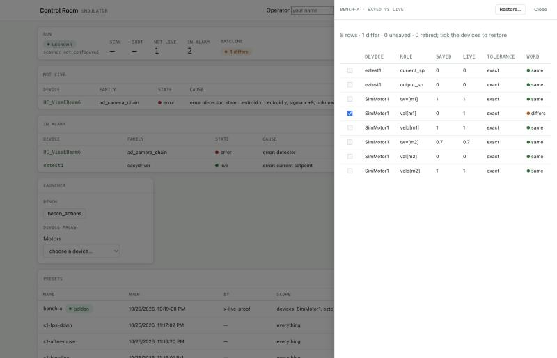

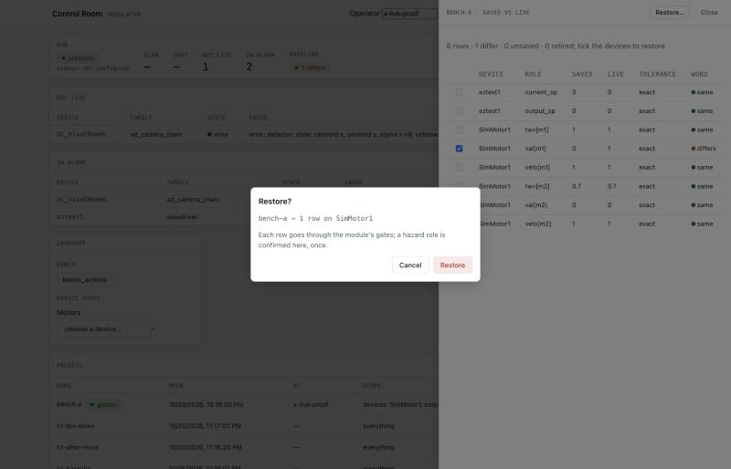

### The device directory

The **Devices** panel at the foot of the home lists every native device
the experiment's registry knows (`native_devices.yaml` and
`panel_devices.yaml` in the configs repo), and every GEECS database device
the module serves, not a chosen few: the launcher above is the curated
layer, the directory is the complete one. Devices are grouped by the page
that draws them (camera, trace, motor, supply, settables); each
group's heading opens that kind's picker, and each device's name opens its
page. A row gives the device's family, the module's word for it (the same
words as the lists above), the IOC that serves it, and that IOC's
heartbeat: `live` while the IOC's own counter advances, `stale` when it has
stopped, `no IOC` when the device has none, `unknown` when the module has
not answered for it. The chip in the panel's
header counts the live devices.

Type in the filter box to narrow every group at once: each word you type
must appear in a device's name or its family (`cam`, `scope`, `test
spectro`); a group with nothing left hides. A device whose family no page
draws yet is listed last, under **no page yet**, without a link, so the
directory is never silently short. When the module does not answer the
rows stay, their words read `unknown` and the panel says why; a device in
the registry that the module does not serve reads `not on the roster`, its
heartbeat `unknown`. A device added to the registry appears on the next
reload of the home.
The LabVIEW devices served through the CA gateway are listed under
**settables** (the database device type is their family; they have no IOC
of their own); they are read from the module once when the home loads, so
while the module is silent they are not listed and the panel says so.

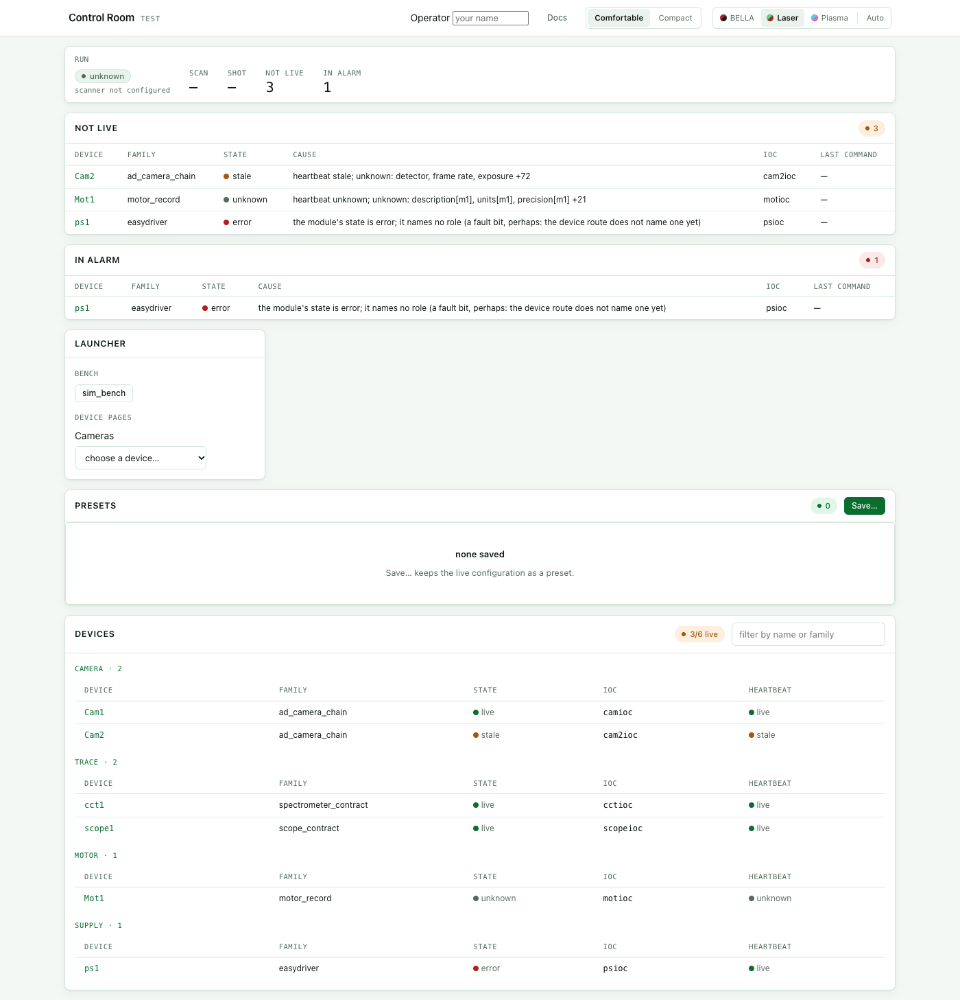

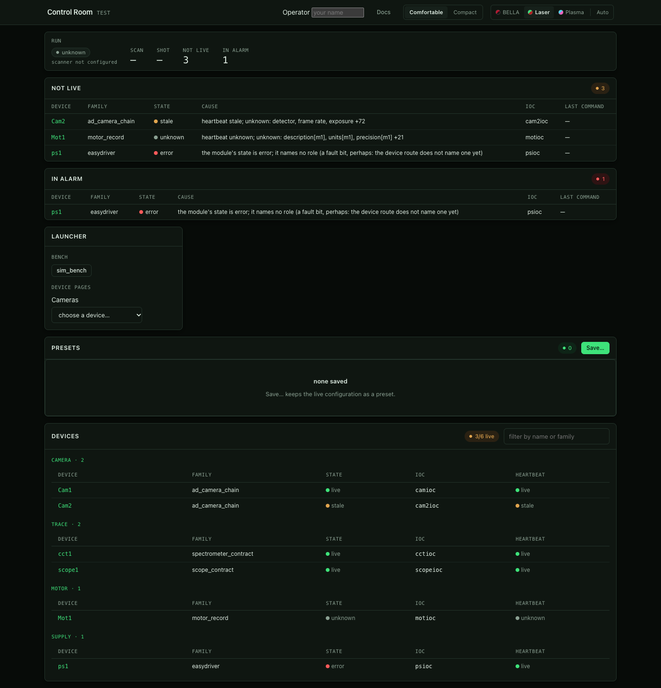

Every device page leads back: its header reads
**Control Room › trace › cct1**, the title the home's link, the kind the
picker's, and the device's name the page you are on.

## A screen

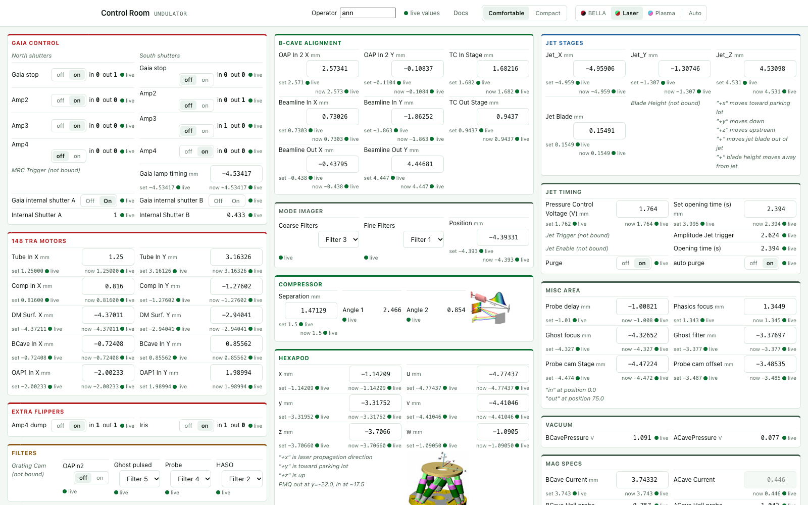

A screen is a grid of titled groups, each a column of widgets. Every
widget shows a label, the value, and a status dot with its word. Its
controls are the device pages' own, so a setting works the same on a
screen as on its device's page.

- A **setpoint** is a setting: the field shows the device's setpoint, with
  `set` and `now` under it and `differs` after a write that did not land
  (see [A setting and the numbers under it](#a-setting-and-the-numbers-under-it));
  hover over the field for its limits.
- A **toggle** is a pair of buttons, off and on (or the device's own two
  words); the pressed one is what the device reads, and pressing the other
  writes it. When the device reads neither, neither is pressed.
- A **flipper** is a toggle with its in and out indicators.
- A **select** is a list of the device's own choices; choosing one writes it.
- A **button** sends a command (a jog, a reset) or runs an action.
- A **readout** is read-only, with its word.
- Text notes and pictures are part of the layout only.

A writing widget is greyed out when the module says the role is not
writable, while a write of yours to it is in flight, or when it is bound to
a raw PV rather than a device role (those are read-only by design).

### Writing

Type a value and press Enter (a setpoint: what you typed stays until the
device takes it), choose an option, or press a toggle's other button or a
button. The widget shows `sending`, then the module's answer:

- `accepted`: the write was made and journaled.
- `denied · <code>`: a rule stopped it before anything was sent (see
  [refusals](#when-a-write-is-refused) below).
- `refused · <code>`: the module or the device would not take it.
- `unknown · no_answer`: the page heard nothing back. The write may or may
  not have reached the device: **read the device and the journal before
  repeating it.**

### The hazard confirm

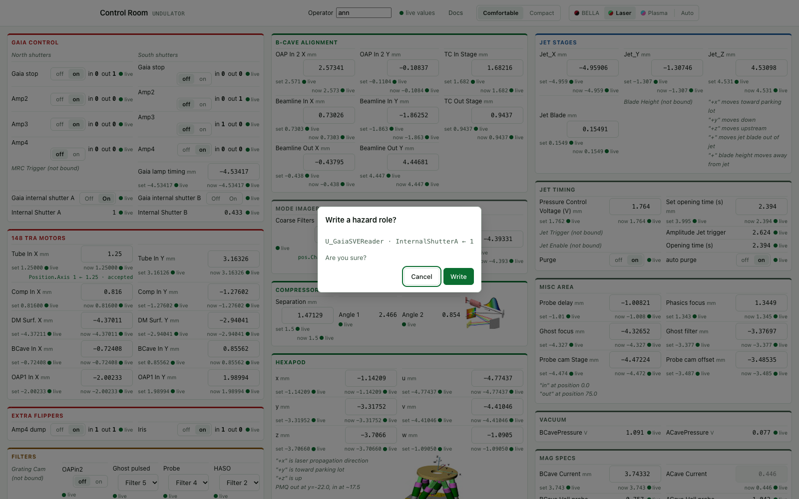

Some roles are marked hazardous (by their device family, by the device's
panel file, by the experiment's policy, or by the screen itself). Writing one opens a dialog
naming the device, the role and the value, with the hazard note. **Write**
sends it with your confirmation; **Cancel** sends nothing (`unsent · not
confirmed`).

### Action buttons

A button may run an **action plan** from the experiment's action library: a
fixed sequence of sets, waits and checks (park a stage, close the
shutters). Pressing it asks once when the plan writes a hazardous role,
then the module runs it step by step, every set through the same checks as
a single write. The button's word follows the run:

| Word | Meaning |
|---|---|
| `ready` | Not running; press to run. |
| `running 2/5` | On step 2 of 5. **Stop** beside it ends the run between steps. |
| `done` | Every step completed. |
| `failed · step 3 · out_of_bounds` | Step 3 failed with that code; the remaining steps were skipped. Hover for the detail (a check's value read, for example). Nothing is retried. |
| `stopped` | You stopped it before it finished. |
| `lost` | The module no longer knows the run (it restarted). The journal says what was written. |

Only one run of a plan at a time: pressing it again while it runs is
refused (`409 already_running`).

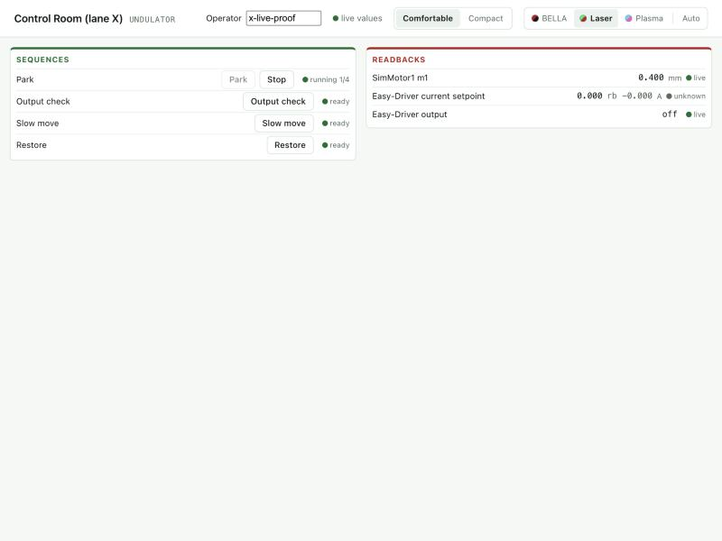

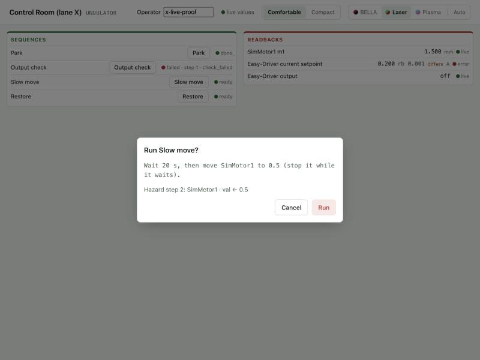

## The camera page

A camera's page (`/device/camera/<name>`, from the home's camera picker)
shows its image with the acquisition controls, crosshairs, the analysis ROI,
the lineouts and the histogram beside it. Its controls are every device
page's: **Acquisition** (Stop / Start, exposure, period, gain, trigger mode),
**Crosshairs** and **Analysis ROI**, each setting with `set` and `now` under
it (see [A setting and the numbers under it](#a-setting-and-the-numbers-under-it)),
and the readings above the image. Two blocks are the camera's own: the
**camera ROI**, whose four fields you edit together and apply behind a
dialog (it changes what every scan with this camera saves), and the
**display** (colour map, scale, levels), which is yours alone and writes
nothing. By default the image is the IOC's
MJPEG display stream: 8-bit and JPEG-compressed, good for watching a beam,
too coarse for a camera's noise (a dark floor flattens to a few grey levels
and a single bright pixel smears into a block).

### Raw view

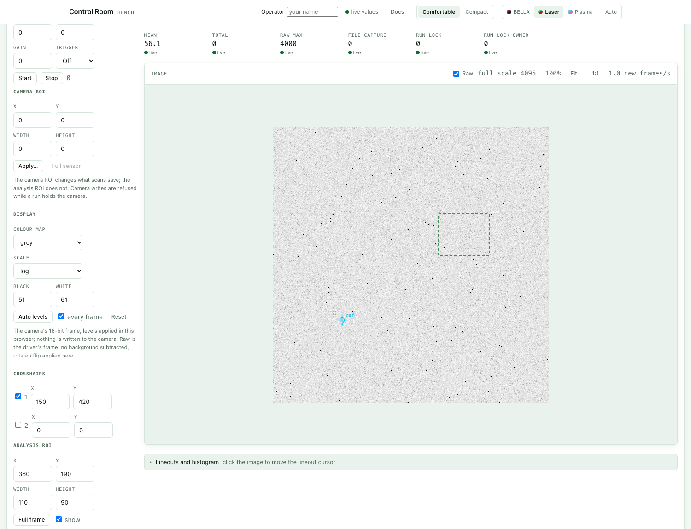

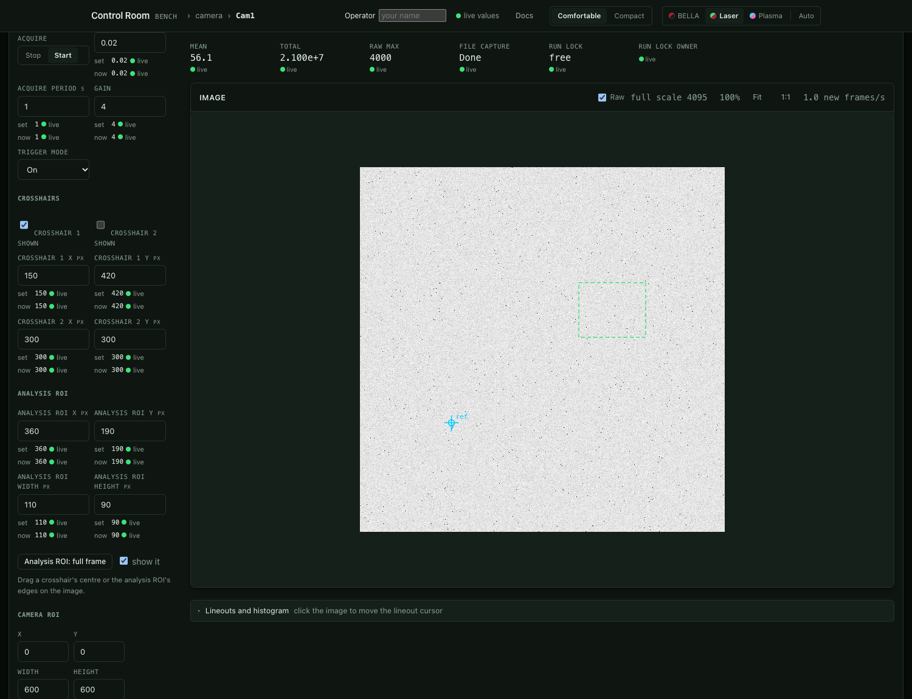

Tick **Raw** in the image header to see the camera's own frame instead: its
12-bit counts, uncompressed, with the colour map, scale and levels applied
in your browser. Untick it to go back. The page always opens on the MJPEG
stream; Raw is never remembered.

**What Raw shows.** The frame as the camera driver produced it, before the
IOC rotates or flips it and before any background is subtracted. "Raw"
means exactly that: a background you see in the MJPEG view is not removed
here. The page applies the camera's rotate / flip setting itself, so the
crosshairs, the analysis ROI and the cursor sit on the same pixels in both
views, and toggling keeps your zoom. When that setting is one the page does
not know, it draws the frame as the driver sent it, hides the overlays and
says `rotate / flip unknown: the driver's frame as is, overlays hidden`.
The note beside the toggle also names a rotation in use (`Rot90 applied`)
and the camera's full scale (`full scale 4095`); `4095 · full scale
assumed` means the camera did not report one.

**Rate.** Raw refreshes at most twice a second, and every viewer of a
camera shares the one frame the server read, so opening more raw views does
not load the camera. The chip at the right of the header reads `new
frames/s`: how many new frames the page received over the last two
seconds. It is not the camera's rate: the page asks twice a second, so it
reads at most `2.0`, whatever the camera runs at. A camera triggered at 1 Hz
reads `1.0` (sometimes `1.5`, as frames fall either side of the window), and
a stopped camera reads `0.0` even though the page keeps asking. Raw is for the lab network; a full-size frame is a few
megabytes.

**Levels.** In Raw the black and white inputs, the cursor readout and the
histogram are in counts of the camera's full scale (0–4095 for a 12-bit
camera), not 0–255. The histogram plot in Raw is the whole raw frame's,
counted in your browser, so it ignores the IOC's histogram setting and
range; the MJPEG view plots the IOC's histogram as before. Each view keeps its own levels: what you set in Raw
does not change the MJPEG view's, and the other way round. **Auto levels**
puts black and white at the 0.1 and 99.9 percentiles of the frame, and with
**every frame** ticked it does that on each new frame.

!!! note "A hot pixel under auto levels"
    Auto levels puts white at the frame's 99.9th percentile, so the
    brightest 0.1 percent of the frame is drawn white. On a dark frame with
    one hot pixel, that 0.1 percent is the noise's top (a few hundred pixels
    of a 600×600 frame) plus the hot pixel, and they are all the **same
    white**: the hot pixel does not stand out. Under the log scale the floor
    is near white too (the screenshots above: the snow is visible, the hot
    pixel is not distinct); under linear the floor is mid grey, but the hot
    pixel is still one white point among the noise's. The scale does not
    change this; the white level does. To single the pixel out, untick
    **every frame** and set **White** to the full scale (4095): under log
    the floor stays visible as dark snow and the hot pixel is the one bright
    point; under linear the floor goes black and the hot pixel is the only
    lit point. Zoom past 1:1 to see it as a block.

Nothing in Raw writes to the camera.

## The trace page

A trace's page (`/device/trace/<name>`) is one page for every device whose
data is an array over a calibrated axis: an oscilloscope's capture over its
time axis, and a spectrometer's spectrum over its wavelengths (its rail:
Acquisition, Trigger and Background; its readings the peak count and
whether the spectrum is saturated, the background's state, and the
integral, peak, centroid and width of the processed spectrum: the
background-subtracted one while subtraction is on). The page is the same
for both: which controls the
rail carries and which readings sit above the plot come from the device's
family file, never from the page.

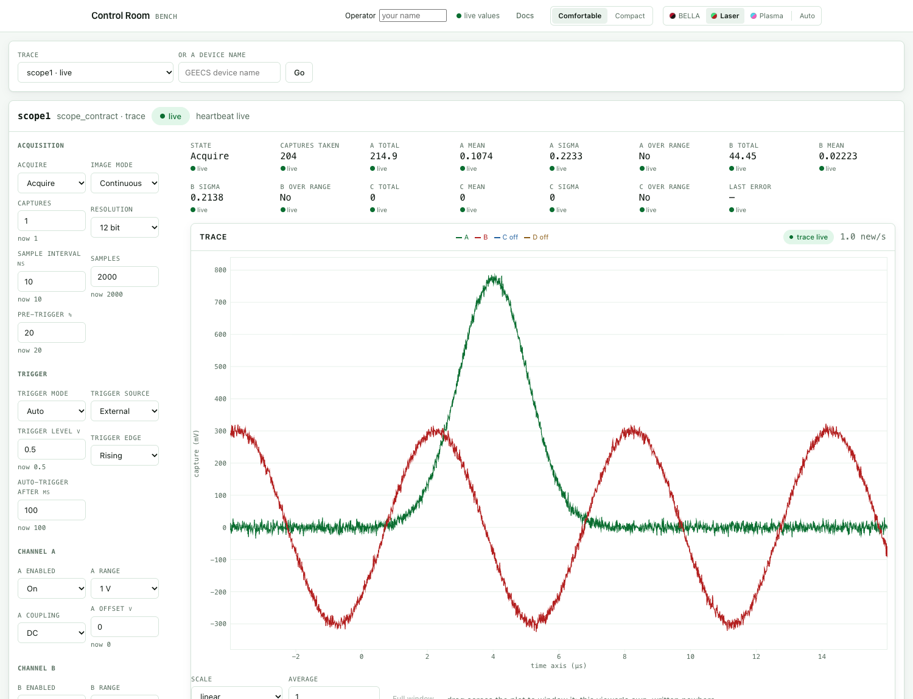

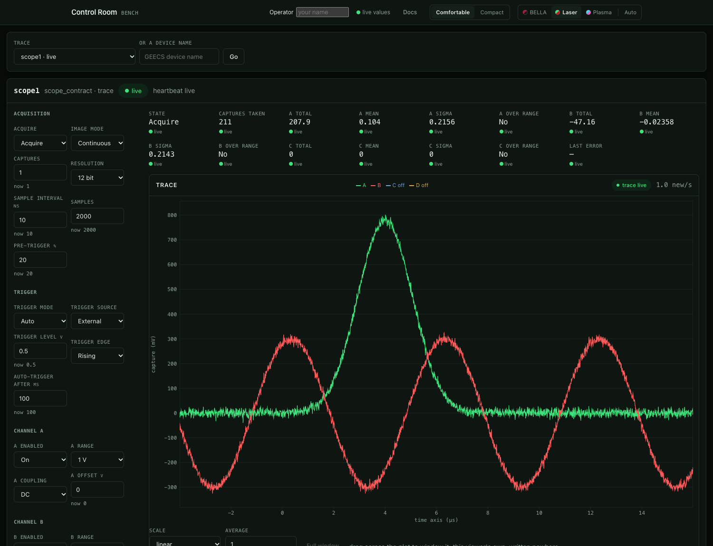

- **The rail** is the family's control groups (for a scope: Acquisition,
  Trigger, one group per channel). Each control is drawn by what it is: a
  choice is a list of the record's own choices, a setting a number field
  showing the device's setpoint with two numbers under it (see
  [A setting and the numbers under it](#a-setting-and-the-numbers-under-it)),
  a switch a checkbox. Acquire
  is a **Stop / Start** pair; the highlighted one is what the device is
  doing now. Every
  write goes through the same path as a screen's, with your name from the
  header; a hazard asks first. A channel the scope does not have (its
  `present` reads 0) has no group and no readings.
- **The readings** carry the module's word, as everywhere.
- **The plot** draws one line per channel (A, B, C, D in the theme's trace
  colours; a disabled channel is listed as `C off` and not drawn), at most
  two new captures a second, and only while the tab is visible. It is
  Plotly in the theme's colours, the plot every line plot in the GEECS web
  pages is moving to (the camera page's lineouts and histogram are next).
  The chip is the capture counter's
  word: `trace live` while captures arrive, `stale` when they stop.
  **Hover** for the readout: the axis value and each channel's value
  there. **Drag across the plot** to zoom in on that part (every sample
  inside is drawn); **double-click**, or the toolbar's autoscale or reset,
  for the whole trace again; the toolbar also pans and saves the plot as
  a PNG. Click a channel's name in the legend to hide or show it.
  **Scale** switches linear and log; **Average** averages the last N
  captures. All of these are yours alone: nothing is written to the
  device. Axis numbers carry SI prefixes only for SI units (`2µ` on a
  time axis in s); a wavelength in nm, counts or a percentage read plain.
- **Show** (a spectrometer): the **raw spectrum**, what the sensor read
  (judge saturation and exposure here), or the **processed spectrum**,
  with the saved background subtracted. While **subtract background** is
  on the page shows the processed one, and the raw one while it is off;
  once you pick one yourself, your pick stays. Show is yours alone too.
  It is not the rail's **spectrum kind**, which is the instrument's own
  setting and changes what the device sends.

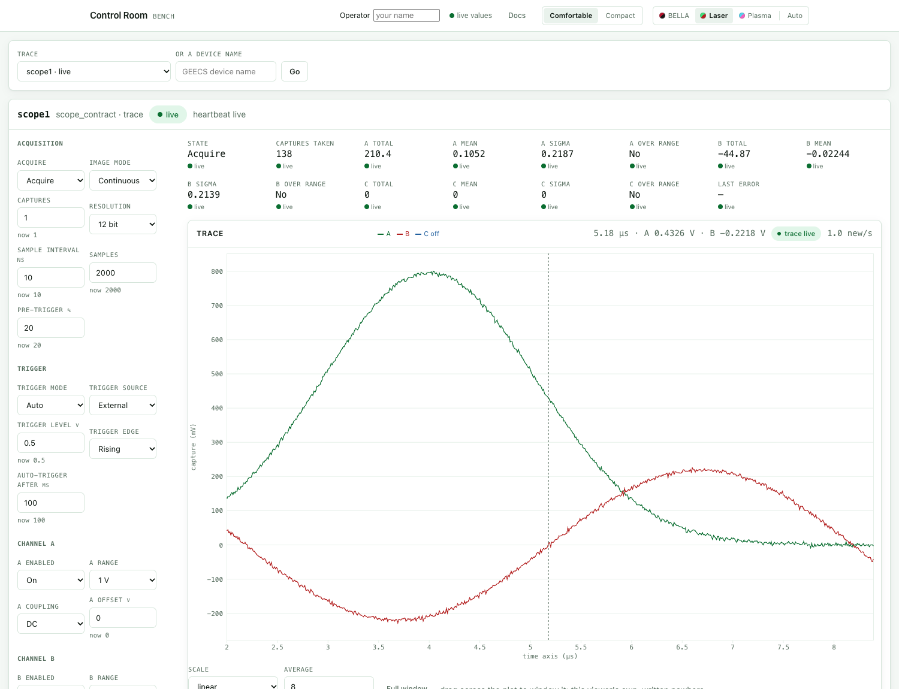

## Settables pages: motors, supplies and every GEECS device

A device with nothing to plot or picture has a **settables page**: a rail
of controls and a row of readings. Motors (`/device/motor/<name>`) and
power supplies (`/device/supply/<name>`) get it, and so does every GEECS
device the module serves from the GEECS database
(`/device/settables/<name>`): a filter wheel, a PLC, a stage, any device
LabVIEW runs. A new device of any of these kinds needs a row in the
registry or the database, never a new page.

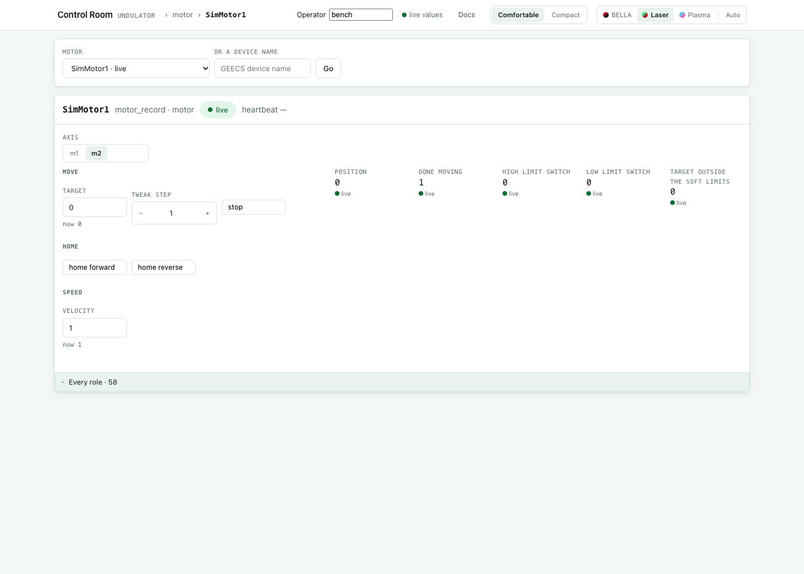

- **The rail.** Its groups come from the device's family when the family
  has a panel. A motor has Move, Home and Speed; a supply has Output and
  Faults. Each control is drawn by what it is, as on the trace page:
  - A setting is a number field showing the device's setpoint, with
    `set` and `now` under it (see
    [A setting and the numbers under it](#a-setting-and-the-numbers-under-it)).
    A text setting is a text field.
  - A choice is a list of the record's own choices.
  - A switch is a checkbox, or a pair of buttons such as a supply's
    **Off / On**.
  - A command is a button.
- **The motor's tweak** sits beside the target: **−** and **+** move it
  back or forward by the step in the box between them. Changing the step
  changes the step size on the motor itself. The motor record does the
  moving, so the page never adds anything up.
- **Axes.** A motor with several axes has an **Axis** selector above
  the rail. Each axis has its own rail and readings, and every write names
  its axis.
- **The readings** carry the module's word, as everywhere. For a motor
  they are position, done moving, the two limit switches, and whether the
  target is outside the soft limits. For a supply they are current,
  voltage, output, and the fault and interlock bits.
- **Writes** go through the same path as a screen's, with your name from
  the header and sent once. A number or text field writes when you press
  **Enter** (the next section says what happens to what you typed), so an
  arrow key or the field's little arrows never move a motor on their own. A step typed
  in the tweak's box and not yet written is sent first when you press
  **−** or **+**. A list, a checkbox or a button writes
  when you choose it. A hazard asks first (a supply's output, a motor's
  home), and the module's answer is shown under the rail.

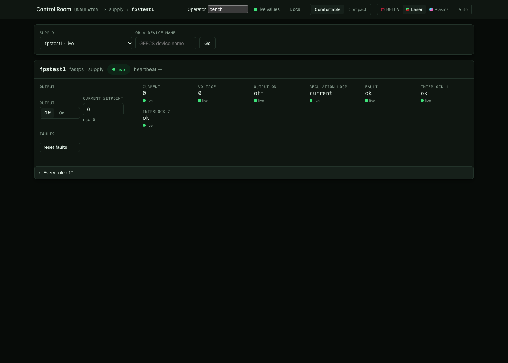

**When a device has no panel**, as every GEECS database device and any
family not yet given one, the page lays it out automatically. Every
setting comes first, in the device's own order. When a device has four
or more switches (a PLC's channels, say), they get a compact grid of
their own, headed **Switches**. Every other value it reports follows as
a reading. Nothing is hidden. The page notes "Laid out automatically"
under the rail.

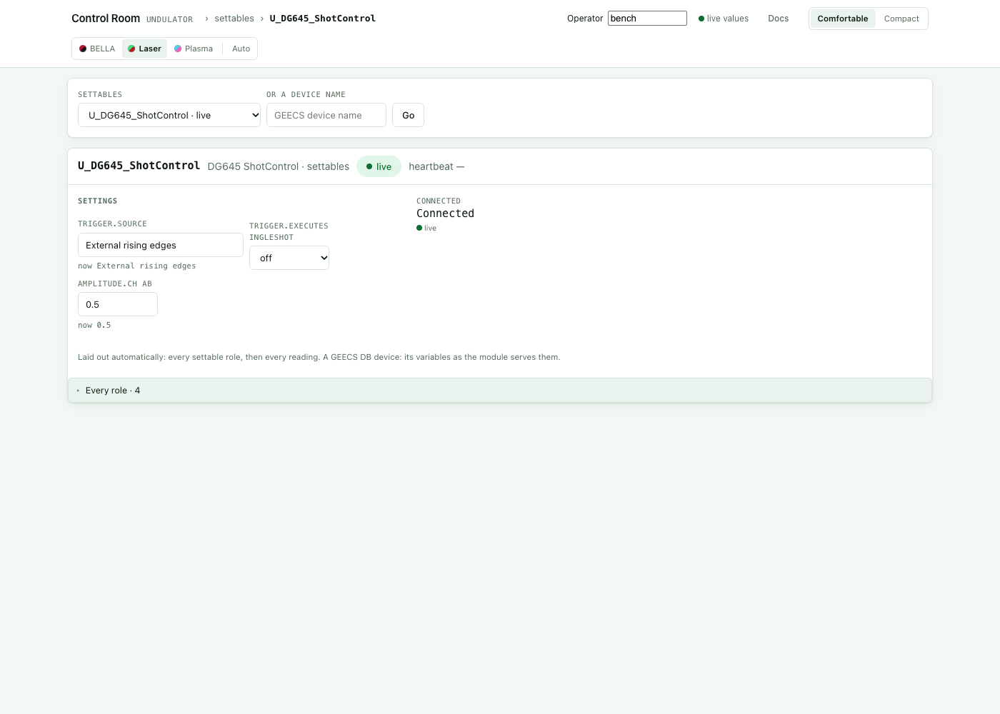

Every role, with its PV and the module's word, is still in the **Every
role** fold under the page.

The home's **Devices** directory lists the GEECS database devices under
**settables** with the rest. It reads them from the module when the home
loads; if the module does not answer, the directory says so and lists
the registry's devices alone.

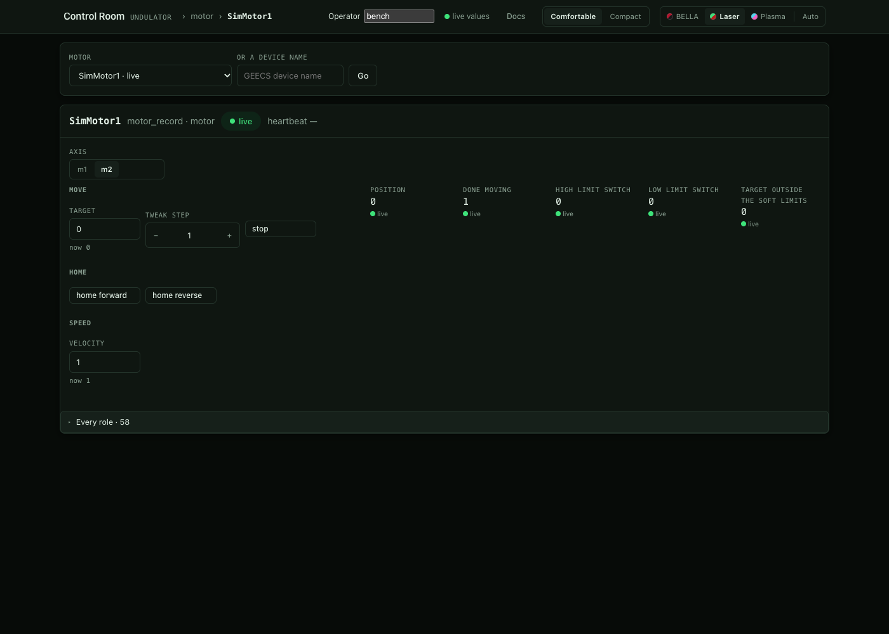

## A setting and the numbers under it

Every setting on a device page (an integration time, a motor's target, a
supply's current) is drawn the same way.

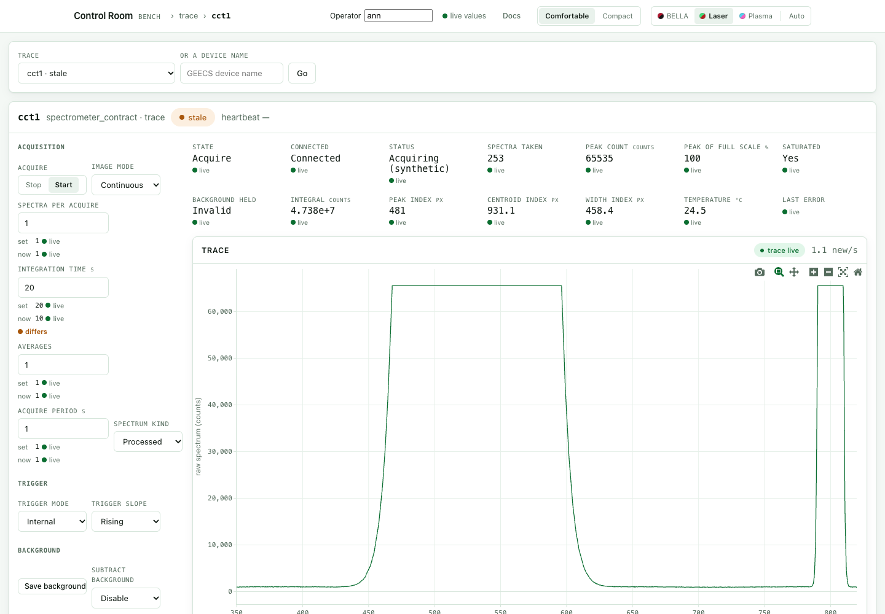

- **The field shows the device's setpoint**, and follows it while you are
  not in it: if someone else changes it, the field changes too. To change
  it, click in, type over it and press **Enter**. While the field has the
  cursor it holds still, so nothing arriving from the device lands in what
  you are typing.
- **What you type is kept until the device takes it.** The field's border
  is marked while it holds your value. It stays when you click away, when
  the write is refused (out of bounds, not permitted, no operator name in
  the header) and when another write is still in flight, so you can fix it
  and press Enter again. It is cleared when the module accepts the write;
  the field then shows the setpoint again. **Esc** drops what you typed.
- **`set`** under the field is the setpoint the device holds now: what you
  (or anyone) last wrote. It is shown where the setpoint is a record of
  its own (a camera or spectrometer parameter, a motor's target, a
  supply's current setpoint, a GEECS device's setpoint PV).
- **`now`** is the measured value: what the device reports it is actually
  using or where it actually is (the integration time the spectrometer
  used, the motor's position, the supply's output current). Where the
  setpoint and the measured value are one and the same record (a motor's
  speed), only `now` is shown.
- Each carries its word (`live`, `stale`, …) like every reading.
- **`differs`** appears after a write of yours has settled (a second after
  the module accepted it, and for a motor once it has stopped moving) when
  `now` is further from `set` than the device's tolerance: the motor's
  retry deadband, a native supply's from its family (5 mA for an
  EasyDriver, 10 mA for a FAST-PS), a GEECS device's tolerance from the
  GEECS database, else one step in the last digit the device shows. It
  means the device did not get where you asked (a value it clamped, a
  motor that stopped short, a supply still ramping). It goes away when the
  two agree again. While the page cannot reach the module it is hidden,
  with every word `unknown`, and it comes back if the two still differ
  once the page hears from the module again. The page only marks writes made from it: a reload, or a
  write from another screen, starts with no mark.
- **A GEECS device** (one LabVIEW serves): the field shows the device's
  value, and `set` is the last value written through the gateway since it
  started, which reads 0 until the first write.

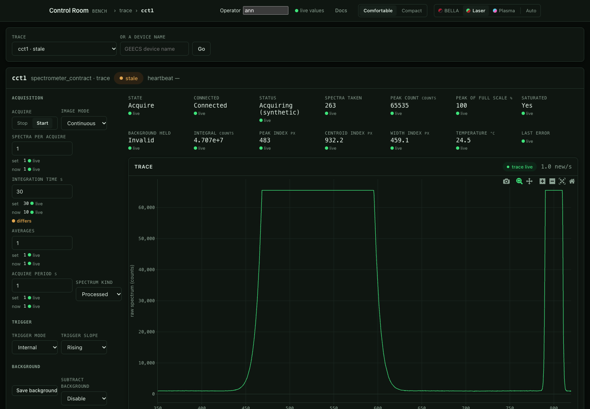

## When a write is refused

The code after `denied` or `refused` says why. The ones you will meet:

| Code | HTTP | In operator words |
|---|---|---|
| `confirm_required` | 428 | This role needs the hazard confirm, and it was not given. Write again and confirm the dialog. |
| `run_lock_held` | 423 | A scan holds this device. Wait for the scan to end (or stop it on the scanner page) and write again. |
| `run_lock_unreadable` | 423 | The module could not tell whether a scan holds the device, so it refused to be safe. |
| `out_of_bounds` | 422 | The value is outside the device's limits (the bracket beside the setpoint). |
| `bounds_unknown` | 422 | The device has no limits recorded, so the module will not write it. For a LabVIEW device, its GEECS DB row needs a min and max. |
| `already_running` | 409 | That action is already running. |
| `nothing_to_restore` | 409 | No row of the preset in scope differs from live. |
| `not_permitted` | 403 | The experiment's policy grants your name no write to this device or role. |
| `not_allowed` | 403 | The role is not on this device's allow list. |
| `journal_unavailable` | 503 | The module could not write its journal, so it sent nothing. Tell whoever runs the services. |

A `denied` answer, and a `refused` one with a code from the table, writes
nothing: the module stopped before the put left. A `refused` answer with
any other code came back from Hare *after* the put was dispatched (a
timeout, a PV that would not connect, a put the IOC rejected), and then
the device may or may not have taken the value: the module's journal
holds an `attempted` row for it, and the readback is the truth. Read the
row's value before writing again rather than assuming nothing happened.
A LabVIEW device (served through the CA gateway) has no run lock: a scan
driving it does not stop a write from here.

## Where to next

- Writing a screen, the home's launcher, an action plan or the write
  policy: [Authoring screens and policy](../geecs_canopy/authoring.md).
- Running scans: [GEECS Scanner](scanner.md).
