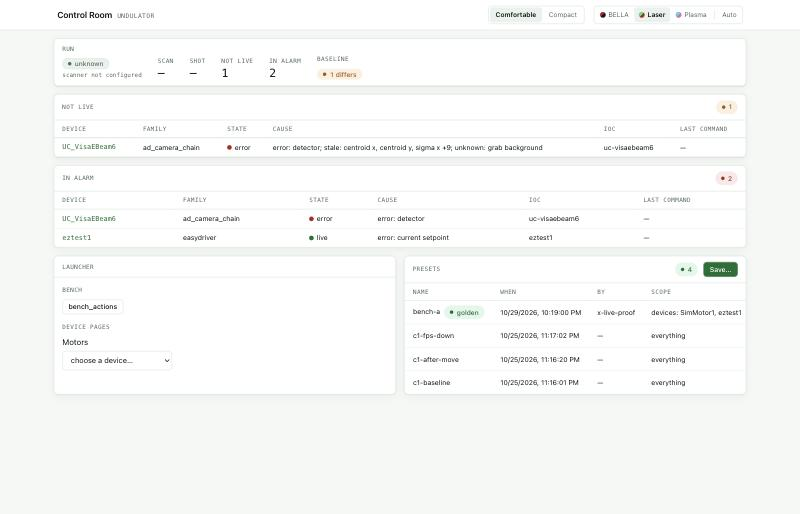
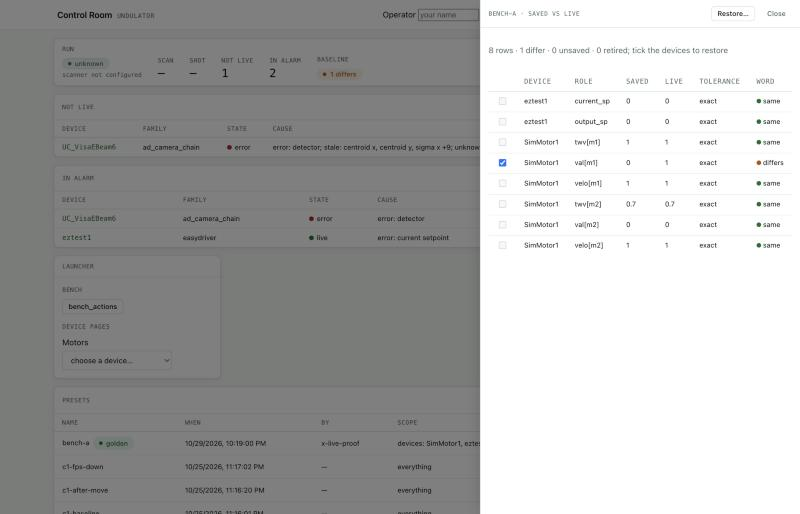
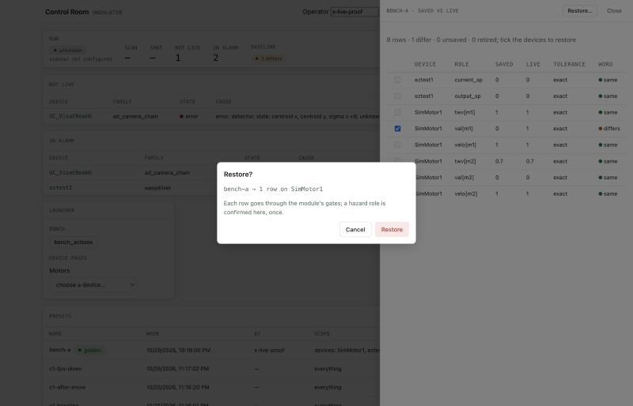
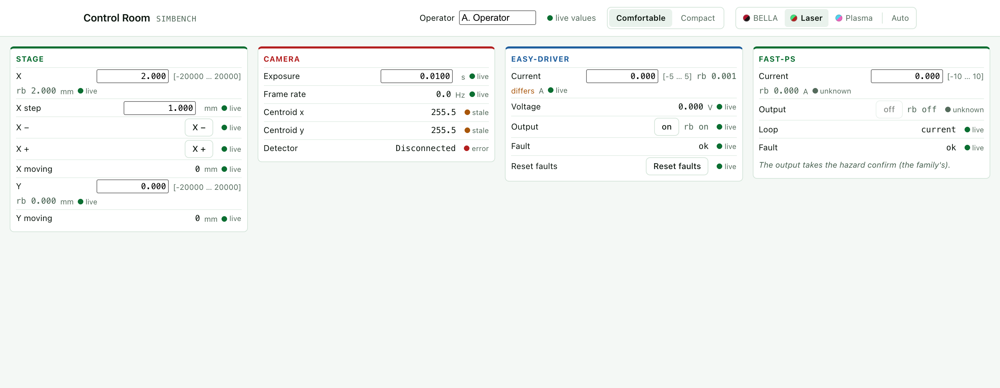
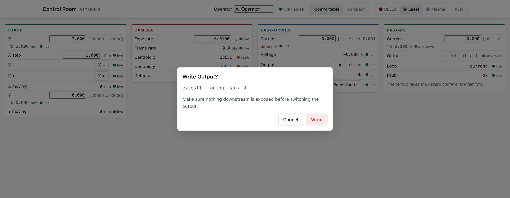
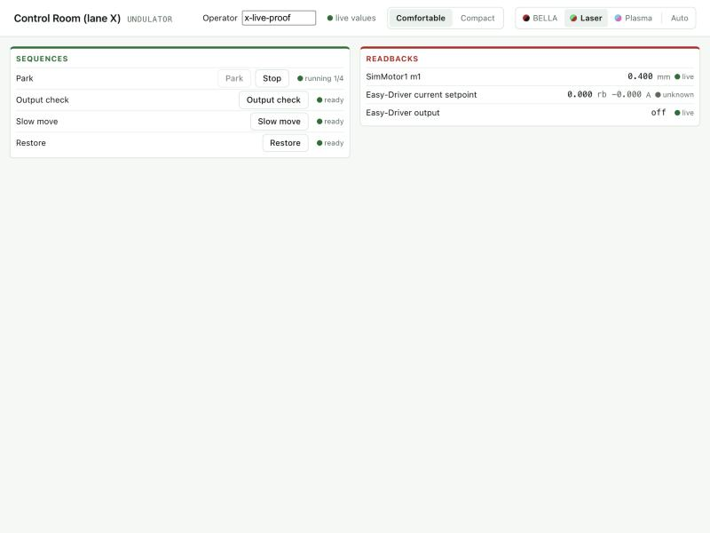
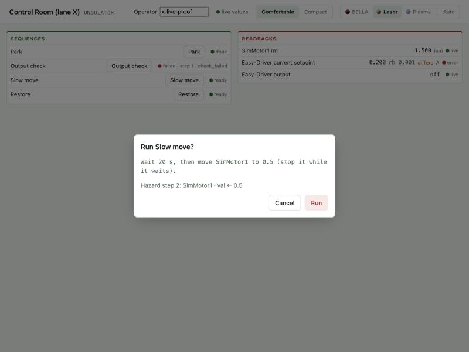

# Control Room

The Control Room is the experiment's home page and its device screens, in
the browser. The home tells you at a glance what is running, which devices
are not live or in alarm, and whether the machine still matches its
baseline. From it you open the screens: dense control panels, one per area,
where you read and set devices. It is a service of its own (port 8700 in
the reference deployment) over Canopy and the GEECS device module, so the
same page works from any machine that can reach it.

Every write you make goes through the GEECS device module, which checks it
(who may write, the device's allow list, the hazard confirm, the run lock,
the limits) and writes one journal row naming you. The page sends each
write **once** and shows the module's answer; it never retries on its own.

!!! note "Name yourself first"
    Type your name in the header's **Operator** field before writing,
    running an action or saving a preset. Without it nothing is sent and a
    screen widget says `unsent · name yourself in the header first`. The name goes
    into the journal; the page remembers it in this browser.

## The home

The screenshots on this page are from the simulator bench, running under
the reference deployment's experiment name.

### The strip

The top row is the summary:

| Field | What it says |
|---|---|
| **Run** | The scan engine's state as the scanner sees it (`idle`, `running`, `paused`, …), with the current scan and shot. `scanner not configured` when the deployment gives no scanner address. |
| **Not live** | How many devices are not fully live. |
| **In alarm** | How many devices have an error. |
| **Baseline** | Shown only when a preset is marked golden. `as baseline` when every saved row matches the live value, `N differ` when some do not, `N not compared` when a row could not be read; it never says `as baseline` while a row is uncompared. |

### Not live and In alarm

Two lists below the strip. **Not live** is every device whose state is
anything but `live`; **In alarm** is every device whose state or any of
whose roles reads `error`. Each row gives the device, its family, its state,
the cause (which roles read which word), its IOC, and the last command the
module journaled for it. A list the module could not give reads `unknown`,
never `none`: an empty list is a fact, an unknown one is not.

The words are the module's verdicts, the same on the home and on every
screen:

| Word | Meaning |
|---|---|
| `live` | The value is being produced now: its counter advanced recently, and it is not in alarm. |
| `stale` | Connected, but the value has stopped updating (its counter has not advanced for a few seconds). The number on screen is old. |
| `off` | The computation behind the value is switched off on the IOC (a statistics plugin disabled, for example). |
| `not answering` | The IOC answers, but the hardware behind it does not (a read, communication or timeout alarm). |
| `unreachable` | The PV is not connected: the IOC, the gateway or the network is down. For a LabVIEW device served by the CA gateway, its device is Disconnected. |
| `error` | A major or invalid alarm, or a tripped fault bit. |
| `unknown` | Nobody can say: the module or the live-value stream is silent, or the record was never processed. |

On a screen you may also see `unknown role` (the screen names a role the
module does not list for that device) or `wrong kind` (the role exists but
does not fit the widget, a setpoint bound to a read-only value, say). Both
are screen-file problems to report, not device faults.

A value changing on screen is never evidence that it is live; only the
word is.

### The launcher

The launcher lists the experiment's screens by area, a device picker per
family (cameras, motors, supplies, …), and links to the other services
(Scanner, Data Portal, Logbook, Config editor). An entry the page cannot
offer (a screen file that does not exist, a service the deployment has
not configured) is drawn disabled with the reason beside it.

### Presets

A preset is a saved configuration: every registered setpoint, read at the
moment you save. The **Presets** panel lists them newest first: name, when,
by whom, its scope, and its run when it is being restored.

- **Save…** opens a dialog: a name, and optionally a scope (families and
  screens from this home). The scope says what the preset is *for*; the
  save itself always records every registered setpoint. Nothing picked
  means everything.
- **Diff** opens a drawer comparing the preset with live, one row per
  setpoint: device, role, saved, live, tolerance and a word: `same`,
  `differs`, `unsaved` (unreachable when it was saved), `retired` (no
  device has that setpoint any more), `unread` (not connected now) or
  `unsupported` (an array). The rows shown are the preset's scope.
- **Restore** opens the same drawer with the differing devices ticked.
  Untick what you do not want written, press **Restore…** and confirm. The
  restore runs as an action in the module: one write per differing row,
  each through the same checks as a write from a screen, the rows that
  take time to settle (a move, a LabVIEW device's set) last. If
  any row would be refused, nothing is written and the refusal says which.
  The run's progress shows on the preset's row, as on an action button
  below. Nothing differing means nothing to restore (`409`, with what the
  rows read).
- **Golden** marks the preset as the baseline for its scope; the previous
  golden preset of that scope loses the mark. The strip's Baseline chip
  compares the golden presets with live every ten seconds.

## A screen

A screen is a grid of titled groups, each a column of widgets. Every
widget shows a label, the value, and a status dot with its word.

- A **setpoint** shows an input with the limits beside it
  (`[-5 … 5]`) and the readback under it (`rb 0.001`). When setpoint and
  readback disagree at the precision shown, the readback says `differs`.
- A **toggle** shows the current state as a button; pressing it writes the
  other state.
- A **flipper** is a toggle with its in and out indicators.
- A **button** sends a command (a jog, a reset) or runs an action.
- A **readout** is read-only.
- Text notes and pictures are part of the layout only.

A writing widget is greyed out when the module says the role is not
writable, while a write of yours to it is in flight, or when it is bound to
a raw PV rather than a device role (those are read-only by design).

### Writing

Type a value and press Enter (a setpoint), or press the toggle or button.
The widget shows `sending`, then the module's answer:

- `accepted`: the write was made and journaled.
- `denied · <code>`: a rule stopped it before anything was sent (see
  [refusals](#when-a-write-is-refused) below).
- `refused · <code>`: the module or the device would not take it.
- `unknown · no_answer`: the page heard nothing back. The write may or may
  not have reached the device: **read the device and the journal before
  repeating it.**

### The hazard confirm

Some roles are marked hazardous (by their device family, by the device's
panel file, by the experiment's policy, or by the screen itself). Writing one opens a dialog
naming the device, the role and the value, with the hazard note. **Write**
sends it with your confirmation; **Cancel** sends nothing (`unsent · not
confirmed`).

### Action buttons

A button may run an **action plan** from the experiment's action library: a
fixed sequence of sets, waits and checks (park a stage, close the
shutters). Pressing it asks once when the plan writes a hazardous role,
then the module runs it step by step, every set through the same checks as
a single write. The button's word follows the run:

| Word | Meaning |
|---|---|
| `ready` | Not running; press to run. |
| `running 2/5` | On step 2 of 5. **Stop** beside it ends the run between steps. |
| `done` | Every step completed. |
| `failed · step 3 · out_of_bounds` | Step 3 failed with that code; the remaining steps were skipped. Hover for the detail (a check's value read, for example). Nothing is retried. |
| `stopped` | You stopped it before it finished. |
| `lost` | The module no longer knows the run (it restarted). The journal says what was written. |

Only one run of a plan at a time: pressing it again while it runs is
refused (`409 already_running`).

## When a write is refused

The code after `denied` or `refused` says why. The ones you will meet:

| Code | HTTP | In operator words |
|---|---|---|
| `confirm_required` | 428 | This role needs the hazard confirm, and it was not given. Write again and confirm the dialog. |
| `run_lock_held` | 423 | A scan holds this device. Wait for the scan to end (or stop it on the scanner page) and write again. |
| `run_lock_unreadable` | 423 | The module could not tell whether a scan holds the device, so it refused to be safe. |
| `out_of_bounds` | 422 | The value is outside the device's limits (the bracket beside the setpoint). |
| `bounds_unknown` | 422 | The device has no limits recorded, so the module will not write it. For a LabVIEW device, its GEECS DB row needs a min and max. |
| `already_running` | 409 | That action is already running. |
| `nothing_to_restore` | 409 | No row of the preset in scope differs from live. |
| `not_permitted` | 403 | The experiment's policy grants your name no write to this device or role. |
| `not_allowed` | 403 | The role is not on this device's allow list. |
| `journal_unavailable` | 503 | The module could not write its journal, so it sent nothing. Tell whoever runs the services. |

A refusal writes nothing to the device. A LabVIEW device (served through
the CA gateway) has no run lock: a scan driving it does not stop a write
from here.

## Where to next

- Writing a screen, the home's launcher, an action plan or the write
  policy: [Authoring screens and policy](../geecs_canopy/authoring.md).
- Running scans: [GEECS Scanner](scanner.md).
