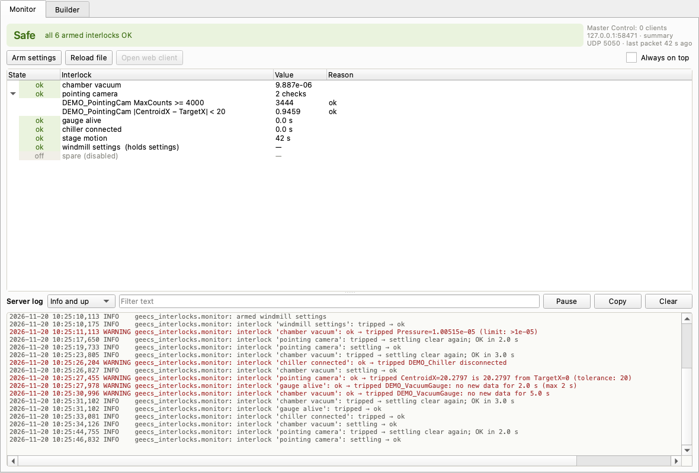
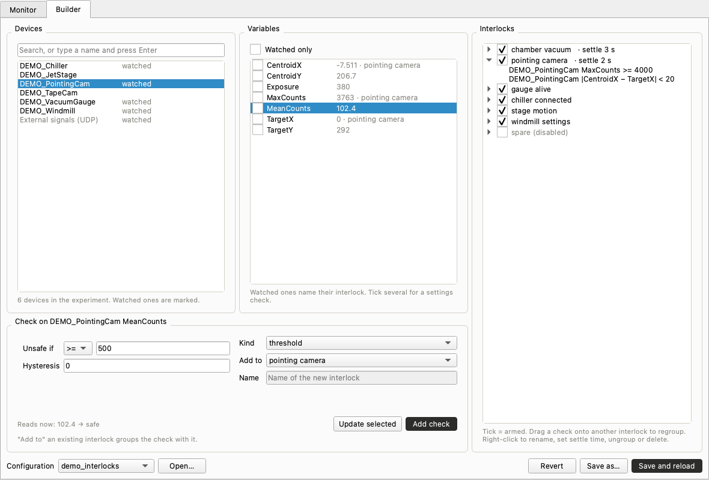

# Interlocks

The interlock server watches device values, and status packets from
programs outside GEECS, against a configuration you build, and tells
**Master Control** whether it is safe. It only reports: what a trip stops is
Master Control's decision.

Unlike the other services it is not a unit on the fleet host: you start it
by hand on the lab PC beside Master Control, where it opens its own window.
Any browser on the network can then watch it on a read-only page.

## Start it

On the lab PC, from the package folder:

```bash
poetry run geecs-interlocks serve --config main
```

`main` is a configuration name: the file `interlocks/main.yaml` in the
experiment's folder of the configs repository. Without `--config` the
server lists the saved configurations and stops. Closing the window, or
Ctrl-C, stops the server.

| Flag | What it does |
|---|---|
| `--config NAME` | Run the configuration `interlocks/NAME.yaml` |
| `--interlocks FILE` | Run a configuration file from anywhere instead |
| `--experiment NAME` | The experiment, when `config.ini` names none |
| `--arm-at-start` | Arm the settings checks once their values arrive |
| `--no-window` | Run without the window (the log stays in the terminal and the log file) |
| `--no-web` | Do not serve the web page |
| `--demo` | Scripted values, no devices: try everything on any computer |

Where the server listens comes from `~/.config/geecs_python_api/config.ini`:

```ini
[interlocks]
; Master Control's stream
status_host = 0.0.0.0
status_port = 5001
; the web page
web_host = 0.0.0.0
web_port = 8600
; external (UDP) signals
external_host = 0.0.0.0
; the daily log files
log_dir = <folder>
```

Comments go on their own line: a comment after a value becomes part of it.

With none of these set, everything listens on this computer only.

## How it fits with the Control Room

The interlocks do not replace the [Control Room](control_room.md): they
answer one narrower question, "is it safe to run?", for Master Control, and
keep answering it when the browser surfaces are down.

| | Control Room | Archiver | Interlocks |
|---|---|---|---|
| Question | What is every device doing, and what should I change? | What did a value do over hours or days? | Is it safe to run, right now? |
| Read by | Operators, in a browser | Operators and analysis, after the fact | Master Control every 0.1 s; operators in the window and on the page |
| Acts on devices | Yes: operators set values through it | No | No: it only reports |
| Reaches devices through | Canopy and its GEECS module | The CA gateway | Its own `geecs_core` subscriptions, plus UDP from programs outside GEECS |

- **Independent path.** The interlocks read devices directly, so an outage
  of Canopy, the gateway or a browser does not blind Master Control.
- **Rules, not displays.** An interlock combines checks across devices and
  outside programs, with hysteresis, settle times and armed settings; the
  Control Room shows each device and leaves the judgment to the operator.
- **Fail-safe.** The Control Room flags a device that is not live; the
  interlocks turn silence, a disconnect or an unreadable value into a trip
  Master Control acts on.

## What it watches

A configuration is a list of **interlocks**. Each interlock holds one or
more **checks** and is unsafe while **any** of them is, so several checks
can be reported under one name (a camera's saturation and its pointing,
say). Master Control sees one line per interlock.

| Check | Unsafe when |
|---|---|
| Threshold | A variable crosses a limit (`>`, `>=`, `<`, `<=`, `==`, `!=`) |
| Alignment | A variable is the tolerance or further from a target variable |
| Stale | A device disconnects, or (with a maximum age) stops publishing |
| External signal | A program outside GEECS sends a UDP packet starting with `warning` or `unsafe`, until it sends one starting with `safe` |
| Settings unchanged | A device's settings move from the values recorded when you pressed **Arm settings** |

An interlock is also unsafe before anything has been heard from its
devices, while a device is disconnected, when a device has sent nothing for
the configuration's `stale_after_s` (5 s unless changed), when a value is
not a number, and while it is **settling**: clear again after a trip but
not yet clear for its settle time.

## The window

### Monitor



- The strip at the top is the verdict Master Control receives.
- The table lists the interlocks worst first; a group opens into its checks,
  each with its own value and reason.
- **Arm settings** records the current settings of the selected interlock,
  or of every interlock holding settings when none is selected. Arm again
  after a deliberate change.
- **Reload file** re-reads the configuration; Master Control stays
  connected, and every interlock waits for fresh values before reporting
  safe again.
- **Always on top** keeps the window above the others.
- The server log under the table shows the same lines as the terminal,
  with level and text filters. Every line is also kept in a daily file,
  `interlocks-YYYY-MM-DD.log`, for 30 days.

### Builder



1. Pick a **device**. The experiment's devices come from the GEECS
   database; watched ones are marked. **External signals (UDP)** at the
   bottom lists the UDP ports in use.
2. Pick a **variable**. Its live value shows beside it, with the interlock
   that already watches it. Tick several for a settings check.
3. Set the **check**. "Reads now" shows what it would say on the live value,
   so you can choose a sensible limit.
4. Choose **Add to**: an existing interlock groups the check with it,
   "new interlock…" starts one. Press **Add check**.
5. In **Interlocks**, the tick arms or disarms an interlock; drag a check
   onto another interlock to regroup it; right-click to rename, set the
   settle time, ungroup or delete. Click a check to edit it, then
   **Update selected**.
6. **Save and reload** shows the changes and writes the file, then the
   server runs it. **Save as…** keeps it as a new configuration. Nothing
   changes until you save.

!!! note "Where a save goes"
    A configuration from the configs repository is never written into the
    checkout the services read: that checkout belongs to the
    [Configurator](configurator.md). The Builder saves it under
    `GEECS_CONFIGS_WRITE_ROOT` (the Configurator's inbox) and runs what
    it wrote; once the Configurator has committed it, **Reload file** reads
    the repository's copy. Until then, **Reload file** reads the repository's previous
    copy, and a configuration saved under a new name reads as none at all
    (reported unsafe). With no write root set, saving a configs-repository file is
    refused; edit it in the Configurator, or run a local copy with
    `--interlocks FILE`, which the Builder saves in place.

A sender's packet must **start** with `safe`, `warning` or `unsafe`
(any case). A `safe` followed by a negation (`not`, `no`, `false`, `off`,
`0`) and anything else is logged and makes the signal unknown, which
counts as unsafe until a recognised packet arrives, so `not safe` can never
read as safe. A sender that also sends keepalive or status packets in other words
trips the signal with each one: it should send only those three words.

## The web page

`http://<lab-pc>:8600/` shows the same verdict and interlocks to anyone on
the network. Nothing on it changes anything.


Click an interlock to see each check's last five minutes against its limit,
and its history. The address keeps the selection
(`?interlock=pointing%20camera`), so you can send someone the link.

!!! warning "No signal"
    If the page stops hearing from the server for 2 s it says
    **No signal**, shows the last verdict with its time, and greys every
    state. It never keeps showing a verdict it is no longer receiving.

## What Master Control receives

A message every 0.1 s on the stream port, holding a single keyword:

```text
SAFE | OK: chamber vacuum | OK: pointing camera
WARNING! TRIPPED | TRIPPED: pointing camera - MaxCounts=4113 (limit: >=4000) | OK: chamber vacuum
```

If the server's evaluation ever stops (one second without a new
evaluation), every frame becomes a trip, `TRIPPED: interlock server -
evaluation stopped N s ago`, until it recovers; the window says **Not
updating**. Master Control is never sent an old verdict.

`poetry run geecs-interlocks listen <lab-pc>:5001` prints what it receives.
The original server's format (`SAFE: <name> | WARNING! <name> - <reason>`)
is available as `wire_format = legacy`, but it repeats the keyword once per
interlock, so Master Control reads it correctly only while a single
interlock is armed.

## Try it on any computer

```bash
poetry install --extras gui
poetry run geecs-interlocks serve --demo --arm-at-start --interlocks examples/demo_interlocks.yaml
```

The demo scripts every device, sends its own UDP packets and moves some
settings now and then, so every state appears within a couple of minutes.
