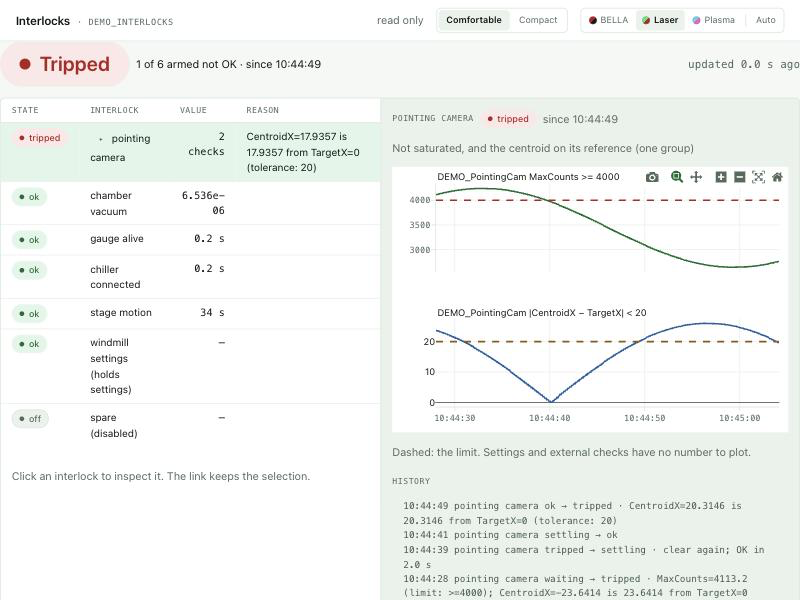

# Interlocks

The interlock server watches device values, and status packets from
programs outside GEECS, against a configuration you choose, and tells
**Master Control** whether it is safe. It only reports: what a trip stops is
Master Control's decision.

It runs headless. Anyone on the network watches it on a read-only page;
configurations are edited in the [Configurator](configurator.md).

## Start it

```bash
poetry run geecs-interlocks serve --config main
```

`main` is a configuration name: the file `interlocks/main.yaml` in the
experiment's folder of the configs repository. Without `--config` the
server lists the saved configurations and stops. SIGTERM or Ctrl-C stops
it; the log goes to stderr.

| Flag | What it does |
|---|---|
| `--config NAME` | Run the configuration `interlocks/NAME.yaml` |
| `--interlocks FILE` | Run a configuration file from anywhere instead |
| `--experiment NAME` | The experiment, when `config.ini` names none |
| `--arm-at-start` | Arm the settings checks with the first values that arrive (see below) |
| `--no-web` | Do not serve the web page |
| `--fake-devices` | Fake GEECS devices on this computer: try everything without the lab |

Where the server listens comes from `~/.config/geecs_python_api/config.ini`:

```ini
[interlocks]
; Master Control's stream
status_host = 0.0.0.0
status_port = 5001
; the web page
web_host = 0.0.0.0
web_port = 8600
; external (UDP) signals
external_host = 0.0.0.0
```

Comments go on their own line: a comment after a value becomes part of it.
With none of these set, everything listens on this computer only.

## How it fits with the Control Room

The interlocks do not replace the [Control Room](control_room.md): they
answer one narrower question, "is it safe to run?", for Master Control, and
keep answering it when the browser surfaces are down.

| | Control Room | Archiver | Interlocks |
|---|---|---|---|
| Question | What is every device doing, and what should I change? | What did a value do over hours or days? | Is it safe to run, right now? |
| Read by | Operators, in a browser | Operators and analysis, after the fact | Master Control every 0.1 s; operators on the page |
| Acts on devices | Yes: operators set values through it | No | No: it only reports |
| Reaches devices through | Canopy and its GEECS module | The CA gateway | Its own `geecs_core` subscriptions, plus UDP from programs outside GEECS |

- **Independent path.** The interlocks read devices directly, so an outage
  of Canopy, the gateway or a browser does not blind Master Control.
- **Rules, not displays.** An interlock combines checks across devices and
  outside programs, with hysteresis, settle times and armed settings; the
  Control Room shows each device and leaves the judgment to the operator.
- **Fail-safe.** The Control Room flags a device that is not live; the
  interlocks turn silence, a disconnect or an unreadable value into a trip
  Master Control acts on.

## What it watches

A configuration is a list of **interlocks**. Each interlock holds one or
more **checks** and is unsafe while **any** of them is, so several checks
can be reported under one name (a camera's saturation and its pointing,
say). Master Control sees one line per interlock.

| Check | Unsafe when |
|---|---|
| Threshold | A variable crosses a limit (`>`, `>=`, `<`, `<=`, `==`, `!=`) |
| Alignment | A variable is the tolerance or further from a target variable |
| Stale | A device disconnects, or (with a maximum age) stops publishing |
| External signal | A program outside GEECS sends a UDP packet starting with `warning` or `unsafe`, until it sends one starting with `safe` (from its `sender` address, when one is set) |
| Settings unchanged | A device's settings move from the values recorded when it was armed |

An interlock is also unsafe before anything has been heard from its
devices, while a device is disconnected, when a device has sent nothing for
the configuration's `stale_after_s` (5 s unless changed), when a value is
not a number, and while it is **settling**: clear again after a trip but
not yet clear for its settle time.

A sender's packet must **start** with `safe`, `warning` or `unsafe`
(any case). A `safe` followed by a negation (`not`, `no`, `false`, `off`,
`0`) and anything else is logged and makes the signal unknown, which
counts as unsafe until a recognised packet arrives, so `not safe` can never
read as safe. A sender that also sends keepalive or status packets in
other words trips the signal with each one: it should send only those
three words. Set the check's `sender` to the sending computer's address so
no other host can clear the signal: a packet from anywhere else counts as
unsafe.

!!! warning "Arming settings"
    A **settings unchanged** check is unsafe until it is armed, and arming
    records whatever values the device reports at that moment. Today the
    only way to arm is `--arm-at-start`, which takes the first values that
    arrive: use it when you start the server by hand with the settings known
    to be right, never in an automatic restart, which would arm a setting
    someone had just changed. Arming from the web page comes next.

## Edit a configuration

Configurations are the `interlocks` kind in the
[Configurator](configurator.md), tier **maintainer**: a change opens a pull
request on the configs repository, so a new limit is reviewed before it
runs. Once it is merged, restart the server to run it; every interlock
then waits for fresh values before reporting safe.

## The web page

`http://<server>:8600/` shows the verdict and the interlocks to anyone on
the network. Nothing on it changes anything.



Click an interlock to see each check's last five minutes against its limit,
and its history. The address keeps the selection
(`?interlock=pointing%20camera`), so you can send someone the link.

!!! warning "No signal"
    If the page stops hearing from the server for 2 s it says
    **No signal**, shows the last verdict with its time, and greys every
    state. It never keeps showing a verdict it is no longer receiving.

## What Master Control receives

A message every 0.1 s on the stream port, holding a single keyword:

```text
SAFE | OK: chamber vacuum | OK: pointing camera
WARNING! TRIPPED | TRIPPED: pointing camera - MaxCounts=4113 (limit: >=4000) | OK: chamber vacuum
```

If the server's evaluation ever stops (one second without a new
evaluation), every frame becomes a trip, `TRIPPED: interlock server -
evaluation stopped N s ago`, until it recovers. Master Control is never
sent an old verdict.

`poetry run geecs-interlocks listen <server>:5001` prints what it receives.
The original server's format (`SAFE: <name> | WARNING! <name> - <reason>`)
is available as `wire_format = legacy`, but it repeats the keyword once per
interlock, so Master Control reads it correctly only while a single
interlock is armed.

## Try it on any computer

```bash
poetry install
poetry run geecs-interlocks serve --fake-devices --arm-at-start --interlocks examples/demo_interlocks.yaml
```

The fake devices are real GEECS device servers on this computer, read the
way the lab's are; the demo also sends its own UDP packets and moves some
settings now and then, so every state appears within a couple of minutes.
