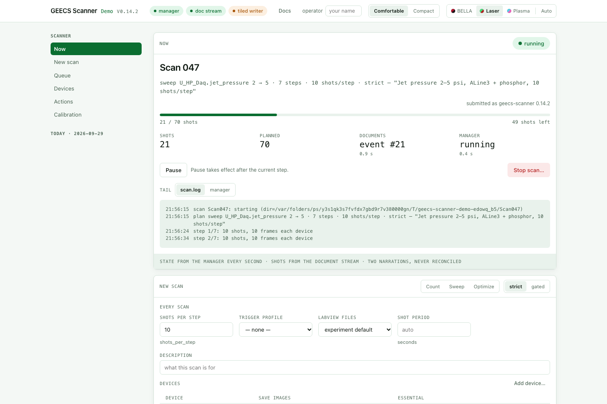
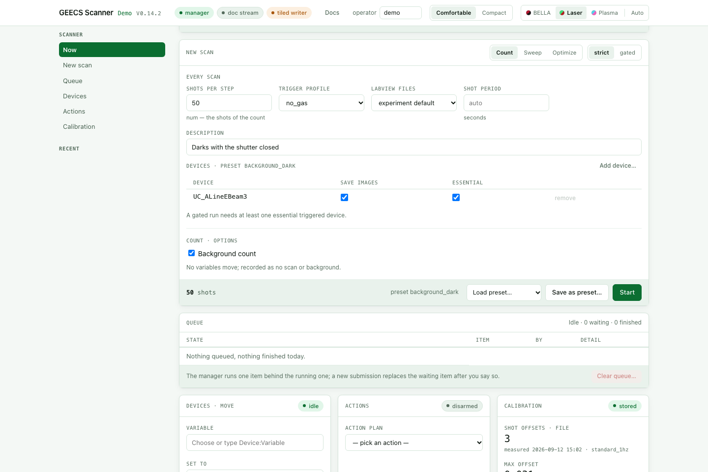
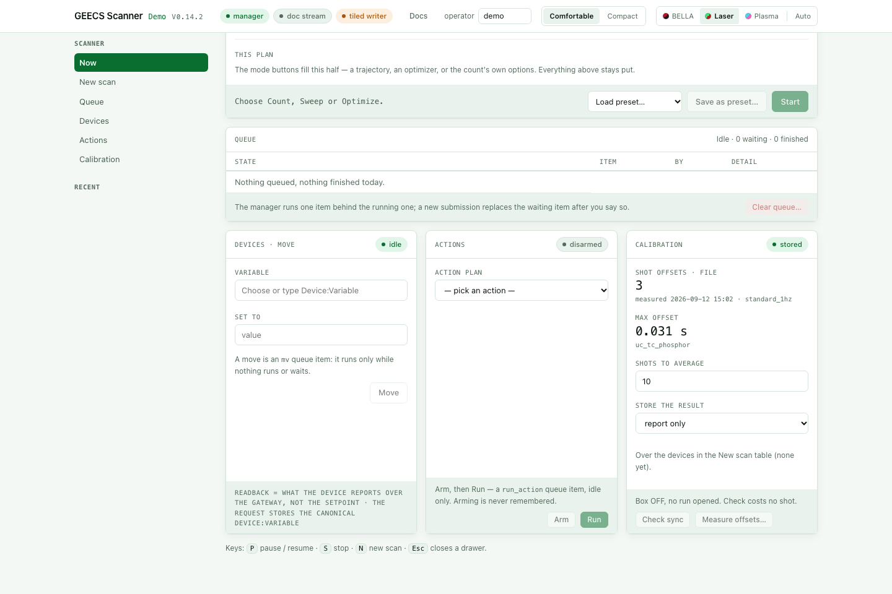

# GEECS Scanner

The GEECS Scanner is the operator front end for running scans on a GEECS
beamline, and it is a web page: open it in a browser, pick or compose a
scan, submit it, watch it run. Scans execute in the Bluesky queueserver
worker ([GeecsBluesky](../platform/fleet_map.md)); devices are reached
through the GEECS Channel-Access gateway; every scan is recorded both as a
classic GEECS scan folder and as a structured run in the Tiled catalog.

It replaced the PySide6 GEECS-Console in September 2026 (final state at
the tag `geecs-console-v0.32.1-final`). Like the console before it, the
scanner is a *client* of the queue, never an engine: everything it submits
can be submitted headlessly from a script with identical results.

## Where it runs

The scanner is a service on the worker host (systemd unit `geecs-scanner`,
port **8300**), beside the [Data Portal](data_portal.md) (8200) and the
[logbook](logbook.md) (8400) — one bookmark each. Nothing is installed on an operator machine: open
`http://<worker-host>:8300/` in a browser on the lab network. The host and
the other services are on the [fleet map](../platform/fleet_map.md).

A hub that runs a **second experiment** gives it a scanner of its own on
another port: an instance in slot *N* adds 10×*N*, so the first instance's
scanner is **8310** and its logbook 8410 (the reference deployment's
pulsed-wire bench, `<unit>@PulsedWire`). The fleet map's
[Experiment instances](../platform/fleet_map.md#experiment-instances)
section names the live ones. If your devices are not in the main
experiment's roster, that scanner is yours: the one on 8300 cannot see
them.

For development, the package runs anywhere from a checkout of
GEECS-Plugins, with or without a real worker:

```bash
cd GeecsScanner
poetry install
poetry run geecs-scanner --experiment <Experiment>   # the real RE Manager, from config.ini [qserver]
poetry run geecs-scanner --demo                      # an in-memory manager that runs scans by itself
```

`--demo` contacts nothing, so the page can be explored offline.

## From a script or an agent

Every control on this page is a route on the scanner's JSON API, and the
API is the contract: the OpenAPI document is served at `/openapi.json`.
Taking data without the browser — a notebook, or an AI agent at an
experiment that has no GEECS-MCP server — uses the same routes, in the
order the page does:

1. `GET /api/devices`, `GET /api/scan-variables`,
   `GET /api/configs/presets` and `GET /api/configs/presets/{name}`: what
   the worker can see, the presets on disk, and one preset's document.
2. `POST /api/preflight` with the preset document. The answer is the list
   of questions an operator must acknowledge; nothing is queued.
3. `POST /api/submit` with the preset, the acknowledged `check` names and
   the `operator`. Preflight runs again, then the scan is queued.
4. `GET /api/status` and `GET /api/progress` to follow it; `POST /api/stop`
   and `POST /api/pause` to halt.

`POST /api/move` moves one settable and completes the way a scan step's
move does: a motor's readback within tolerance, otherwise the device's own
set completion.

A preflight question is for a **person** to answer: an agent relays it and
waits, and never acknowledges one on its own. And data is never taken by
writing to devices directly (`GeecsDevice.set`, or a gateway `:SP` PV):
that path has no scan number, no save set and no shot control, and
nothing records that it happened.

## A tour of the page



The rail on the left lists the page's sections; the **health chips** in
the header say whether the RE Manager answers (`manager`), whether the
worker's document stream is being heard (`doc stream`), and whether the
Tiled writer is keeping up (`tiled writer`). When the trigger profile
the form will submit under names a software interlock server (the
profile's `shot_gate`, edited in the configurator), a fourth chip shows
that server's latest verdict: `shot gate: safe`, `shot gate: not safe`
(hover for the server's reason), `shot gate: unreachable`, or
`shot gate: unknown` while it connects or when the profile itself cannot
be read. Pick a profile without a gate (laser off, say) and the chip goes
away. The chip only shows the server's verdict: the worker also holds
every shot until the server says safe about data taken after the previous
one, so a scan can wait for a moment while the chip reads safe. **Docs**
opens this page.

- **Current** — the running scan: state, the claimed scan number, progress
  against the planned shots, and a live tail of the scan's own `scan.log`
  (the manager's console text sits behind a toggle). **Pause**, **Resume**
  and **Stop scan…** live here and act on the running item.
- **New scan** — the form. **Load preset…** fills it from a saved scan
  document in the experiment's configs repository, or compose one. The
  top half is common to every scan: shots per step, trigger profile,
  whether LabVIEW saves its own files, shot period, a description, and
  the devices table (which devices to record, whether each saves images,
  and which are required: a required device is waited on every shot and
  a shot it misses is refired; the others record what they take). A
  device that is not required and is down when the scan starts is left
  out of that scan with a warning (no columns); a required one, or a
  device the scan moves, refuses the scan when down. Leave the row in place: the next scan that finds the
  device up records it again. The mode buttons fill the bottom half:
  **Count** (N shots at a fixed configuration, optionally tagged as a
  background), **Sweep** (one or more variables along a trajectory) or
  **Optimize** (an optimizer drives the variables). Acquisition is
  **strict** (one fire per shot, one row per fire); **fly** (a software
  tick, the box never driven) is a preset's `acquisition: fly`, with no
  button yet. The gated mode was deleted on 2026-11-14: a preset that
  still asks for `acquisition: gated` is refused with the reason, never
  run as something else. Press
  **Start** — see [Running a scan](#running-a-scan) for what Start does.
  The current form can be saved back as a preset (**Save as preset…**):
  the configurator commits it to the configs repo under the operator's
  name (fill in the operator field first).
- **Queue** — three sections, each one folding: **Ongoing** (the running
  item), **Waiting** (in execution order, each with **Remove**) and
  **History** (newest first, with the scan number and who started it);
  **Clear** empties what waits. **Add to Queue** beside Start appends the
  scan to the end (the same preflight, no title dialog); Start replaces a
  waiting item after you say so. While the queue is stopped with items
  waiting (a failed scan returns to its front), Add to Queue refuses
  until you remove or clear them.
- **Devices · move** — every numeric settable variable of the experiment,
  straight from the GEECS database, behind a type-ahead: type any fragment
  of the device, the variable or its alias to narrow the list. Pick one and
  the page shows its live **readback** (the gateway's readback PV, never the
  setpoint) with the reading's age; enter a value and **Move** queues a
  single move. Moves run only while the queue is idle — the panel's chip
  says `idle`, `a plan is running` or `items wait in the queue`.
- **Setups** — the experiment's setups (named device states): pick one,
  preview every step (nested setups inlined, hazard steps marked), **Arm**,
  then **Apply**. The scanner then asks you to confirm the setup's writes
  and each hazard step before it queues one `apply_setup` item. Arming is
  never remembered — it is asked for on every apply. Idle only. A device
  the setup writes or checks that reads disconnected refuses the setup
  before anything is written; one that drops off during the setup fails
  the next check on it, naming the writes already made. (A native EPICS
  motor has no disconnected reading yet, so it is not judged.)
- **Calibration** — the stored per-device shot offsets, with **Check** and
  **Measure** verbs over the devices in the New scan table and the chosen
  trigger profile. Idle only.

## Running a scan



1. Pick a preset in **New scan**, or compose a scan and pick a trigger
   profile.
2. Press **Start**. With **confirm title** ticked beside it (the default,
   remembered per browser) Start first asks for the scan title, prefilled
   from the description; then the page runs the pre-submit **preflight**.
   Refusals (an unknown name, a variable no device serves, a worker that
   is not ready) come back as text and nothing is queued. Warnings come
   back as *questions* — stale cameras, a trigger that looks off — in a
   dialog; nothing is queued until every question is acknowledged and you
   press **Submit to queue**. The acknowledgements are stamped into the
   run's metadata. A clean preflight queues the item at once — Start is
   not a dry run (the dry run is the API's `POST /api/preflight`).
3. The item lands in the queue and, when the worker is idle, runs; **Current**
   follows it shot by shot.
4. **Stop scan…** aborts at the next safe point and restores the trigger
   to its standby state. An aborted scan's folder is kept, never deleted.

The preset *is* the submission document (`geecs_schemas.Preset`: a device
group, a plan call, a trigger profile). The scanner expands it with the
same `expand_preset` every client uses and binds no device itself, so a
preset submitted from a notebook through `geecs_bluesky.qs_client` — or
through the page's own JSON API, `POST /api/submit` — behaves exactly as
one submitted from the form.



## Where the data lands

Every scan is recorded twice, deliberately: the classic GEECS scan folder
on the data share (`scans/ScanNNN/` with `ScanInfoScanNNN.ini`, the
`ScanDataScanNNN.txt` s-file exported after the scan, `scan.log`, and each
device's natively saved per-shot files), so every existing analysis tool
keeps working; and a run in the Tiled catalog with the start/stop metadata
and one event row per shot. Only the worker ever creates a scan folder.

Read it back in the [Data Portal](data_portal.md) (day → scan → metadata, scalar plots,
images, from any browser) or from Python through the `ScanCatalog` layer
and the s-file readers in [Data Utils](../geecs_data_utils/overview.md).
The column contract is `GeecsBluesky/EVENT_SCHEMA.md` in the repository.

## When something is wrong

- **`manager` chip down** — the RE Manager does not answer. The
  queueserver stack lives on the worker host; see the
  [fleet map](../platform/fleet_map.md) for the units and their probes.
- **Preflight says the worker is not ready**, or a submit is refused with
  *"not in the list of allowed plans"* — the worker's RunEngine
  environment is closed or its plan list is stale. That is a worker-side
  fix (the readiness unit reopens it); the page cannot do it.
- **A scan sits between shots and the `shot gate` chip reads not safe** —
  the worker is waiting for the gate's permission (the reason is in the
  chip's tooltip and the scan log). After `hold_pause_s` (default 60 s)
  the scan pauses with that reason; **Resume** waits for safe again and
  never fires without it. `shot gate: unreachable` refuses new scans
  before anything moves, and so does a server that connects but sends
  nothing. The `gate_hold_s` column records each shot's wait.
- **`doc stream` chip down while a scan runs** — the page still shows the
  queue's state, but no shot-by-shot progress. Scans are unaffected.
- **Move, Setups and Calibration are held** — the move chip reads
  `a plan is running` or `items wait in the queue`; they open again when
  the queue is idle.
- **The scan folder is missing data** — start at the scan's `scan.log`
  (the **Current** tail, or the file in the scan folder) and the repository's
  `/triage` skill.
